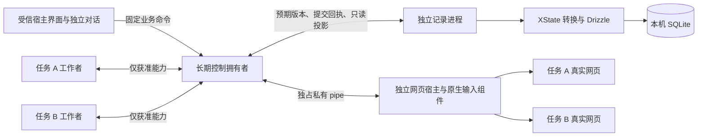

# 首版工程技术栈方案

日期：2026-10-14。状态：整体已确认并已提交；用户再次调用 implement，恢复事项 01 已确认范围。实际组合与待验收部分见[工作区核对](../../docs/testing/evidence/workspace-01/REPORT.md)。

用户在 Q18 明确选择“整体理解一致，按方案推进（推荐）”。本方案作为首版工程依据；工具支持声明仍需实际组合验证，后续功能仍逐项遵守原型确认。

随后用户要求“请先提交技术选型的规划，不要继续编写代码了”。本次提交仅包含工程方案、评审记录、架构决定和事项状态说明；先前实现候选留在工作区，不纳入规划提交。

本文集中记录已选工具、职责、验证缺口和落地顺序；逐轮答案、备选比较与官方证据见[工程技术栈评审](engineering-stack-review.md)。包管理已选择 pnpm，日常检查、版本维护、性能测量及素材／定时工具的选择时机均已确认。

选型遵循三项取舍：由 AI 维护、人类实测验收；维护与验证优先于最快做出第一包；通用能力优先采用成熟工具，确有必要才自研。保留现有实现候选，但不以已经写出的代码决定技术路线，也不把它计作事项完成。

## 已确认的架构

- Electron 承载真实网页和独立宿主对话；网页不取得宿主和模型权限。
- Playwright 操作网页；控制拥有者持有私有 pipe，工作者仅经受管通道取得对应任务的能力。
- 一个持久记录拥有者和本机 SQLite 统一保存关联事实；业务资料独立于安装包。
- 首版在当前 Mac 自用，首批正式实现遵循已确认原型。首次对外使用前办理正式签名和公证，自动下载安装留待盈利后。

依据：[ADR-0003](../../docs/adr/0003-electron-controlled-execution.md)、[ADR-0004](../../docs/adr/0004-local-durable-records.md)、[实现规格](../helpr-first-release/spec.md)。本次补齐工程选择，不重新修改以上决定。

## 已选组合与取舍

| 部分 | 选择 | 比较和取舍 |
| --- | --- | --- |
| 正式代码语言 | 已确认 TypeScript 严格检查＋Zod | 对任务、页面、消息和执行身份提供统一类型，跨进程和未知输入仍做运行时校验。格式校验不能代替执行权限。实验和已有独立检查脚本可以继续 JavaScript；具体版本待组合核对。 |
| 宿主界面 | 已确认 React | 已确认由 AI 维护、人类实测验收。React 和 Vue 3 都能自动进行类型及行为检查，没有证据证明 AI 更擅长维护某一个。具体差异、选择理由及重新考虑条件见评审记录。 |
| 界面样式与交互基础 | 已确认 CSS Modules、按需 React Aria | 保留已确认的视觉变量、SVG 图标和第 4 款标签栏。借助无样式交互组件处理需要的键盘、焦点和浮层，具体使用仍须符合已确认行为并经过输入与焦点检查。 |
| 业务状态管理 | 已确认 XState 稳定 5.x | 在唯一记录拥有者中表达任务生命周期的层级、并行和合法转换。保存相关事实后仍经统一入口派发，恢复先核对；界面只订阅投影，首版不再叠加第二个全局状态库。 |
| 开发与编译 | 已确认 electron-vite 稳定发布 | 显式编译控制、宿主、记录、工作者和独立 CJS preload 入口；暂不走实验性隔离构建。宿主 UI 产出本地静态资源，真实网站不由其构建；类型检查单独执行。 |
| 桌面打包与原生构建 | 已确认 electron-builder 稳定 v26＋node-gyp | 管理生产依赖、原生构建、ASAR、fuses 后签名及安装产物；明确资源与路径。Forge＋Webpack 是有效备选，具体比较与包内门槛见评审。首版不启用自动下载安装。 |
| 进程通信 | 已确认 Electron 原生通信＋Zod 业务契约 | 固定命令、可信通道角色、任务／执行／请求身份和版本；超时与迟到不自动恢复资格。不再叠加通用 RPC 框架。 |
| 本机诊断 | 已确认 Pino＋pino-roll | 结构化事件、关联字段、白名单和脱敏，有界轮转，默认无云遥测。异步诊断不替代持久业务事实；具体包内路径与退出尾部行为需验证。 |
| 模型客户端 | 已确认 AI SDK Core＋直连 provider | SDK 处理协议与流式，helpr 控制资格、预算、每次发送、取消和未知用量。关闭隐式重试、默认 Gateway 和内容 telemetry，不交给 SDK 自主执行网页。 |
| SQLite 接入与迁移 | 已确认独立记录进程＋`better-sqlite3`＋Drizzle ORM／Kit 稳定发布 | 通过类型化结构、查询及可审查迁移减少通用自研。`better-sqlite3` 13 的 N-API 仍需实际包兼容；迁移备份、中断恢复和历史库验证由产品负责。未选择内置 `node:sqlite`＋自行管理迁移或 Kysely 路线，具体取舍见评审。 |
| 检查 | 已确认 Vitest＋React Testing Library；类型化 ESLint＋React Hooks＋Prettier，Q14 | 沿用已确认的三组公开入口，旧实验 node:test 保留；现成规则检查模块边界，类型检查单独执行。真实中文输入法、锁屏等按真人安排；普通浏览器检查不能代替私有控制及最终包验证。 |
| 包管理与组织 | 已确认 pnpm；一个应用、一个锁文件和必要的本地原生包，Q14 | 默认隔离布局，明确依赖构建许可，正式应用只保留 pnpm 锁文件；历史实验独立保留。验证干净冻结安装、原生构建和真实包，不额外引入多项目构建平台。 |
| 版本维护 | 已确认固定兼容组合、独立升级与受影响能力复验，Q15 | 精确依赖、锁文件、工具链和来源记录；不批量自动升 Latest 或自动 audit fix。现有实验版本仅作候选，具体组合核对后锁定。 |
| 性能验收 | 已确认首个贯通包测量并据此确定数值门槛，Q16 | 在当前 16 GB Mac 区分宿主启动／切页、双任务资源及持续运行，网站与模型等待单列。停止与接管顺序从开始即为硬要求；尚未运行性能实验。 |

React 和 Vue 都能落实已确认的视觉与交互，选择不会要求用户重新体验同一原型。实现引入新行为时仍须更新原型并取得对应确认。

## 进程与状态的分工

图中展示职责与连接，不表示同步调用或已实现。数据库慢查询、迁移和备份隔离于控制事件循环；原生输入仍在网页宿主的 AppKit 所属线程。网页 renderer 不取得宿主桥、密钥和任意本机文件能力；工作者不直接持有裸 CDP 连接。

- 开始动作先可靠保存关键记录，再经过控制拥有者的当前资格检查。提交回执不构成永久权限，旧回执不能绕过后来的停止、接管或页面变化。
- 停止先在执行路径阻断新派发并撤销旧资格，再保存事实；记录失败时暂停依赖它的自动工作。尚未保存的停止不能被宣称必然跨崩溃保留。
- XState 计算转换，允许的业务命令及可序列化参数经 Zod 校验后提交；不把原始 actions、函数和 actor 引用当作持久协议。提交失败不能让内存投影冒充已提交事实。
- 恢复核对已有记录及网页实际结果，不直接启动快照中会再次发布的 invocation；迟到成功可以登记，但不能解除停止。各任务分别建模，不建立一个包含所有工作的巨大状态机。
- 单项工作者退出不结束另一项任务；控制拥有者退出须关闭并独立核对自有进程。物理分离没有增加第二个持久记录权威。

这些是已选工程职责，具体实现仍须证明输入次序、保存失败和恢复等既定保证。不能把这张图当成完整组合通过的证据。

这一跨进程取舍及 XState 执行边界已记录为 [ADR-0005](../../docs/adr/0005-record-process-and-state-transitions.md)；没有为每个库单独建立 ADR。

## 模型、数据和诊断的边界

AI SDK 显式配置直连 provider，不由模型字符串默认转往 Gateway；网页工具不提供自主执行入口。关闭隐式重试，每次重新发送重新核对和计账。当前调查的 v7 需设置 `maxRetries: 0` 且省略 `streamRetries`；后续版本重新核实。生命周期通知回调抛错不能作为唯一资格门禁，实际发送前仍需检查。核对原始用量完整性，缺失字段保留未知，取消不能证明服务端未计费。

数据迁移生成后审查并冻结，不对用户库运行开发期结构同步命令。数据库备份不自动包含素材文件，一致快照与引用文件由记录拥有者协调；凭据及网站会话按既定规则排除。better-sqlite3 13 的 N-API 改变了旧 ABI 假设，仍不省略原生包和安装验证。

日志仅接受限定事件、关联 ID、错误码和耗时等字段，不直接序列化完整消息、网页、模型内容或任意异常字符串。每个进程独占文件，诊断轮转不删除业务历史和恢复证据。本轮没有选择云端错误收集、托管状态检查或自动崩溃转储。

正式应用固定 Node、pnpm 和兼容依赖组合，由同一版本来源配置本机及 CI，冻结安装不允许隐式改锁文件。依赖和许可证清单必须读取实际 pnpm 依赖图及最终包内容；不因调查过 npm 专用命令就声称其可以直接检查 pnpm 锁文件。生产原生构建与 Electron 二进制准备分别核对，旧实验的安装方式不直接复制到产品。

## 尚需由实现取得的证据

Q17 已确认：素材解析与定时工具在事项 18／20 的功能原型中，以实际文件格式、公式与日期情况、时间表达及夏令时例子决定具体库和版本；通用解析与历法采用成熟工具，产品继续负责版本、确认、去重和恢复。这不减少表格内容处理或定时工作的首版范围。

1. 上述构建工具能够保留独占 pipe、自有进程生命周期、sandbox 和受限 preload，打包后没有裸调试端口。
2. 独立记录进程中的 better-sqlite3 与 Drizzle 在实际安装包内可用；真实迁移、提交回执丢失、慢盘与记录失败不会绕过控制资格，宿主 Node 测试不能代替内嵌运行时验证。
3. Cookie 加密从第一次建立正式资料区即开启。自用签名方式、macOS 钥匙串授权及冷重开保留以实际包验证；不能用 SQLite 保护代替网页登录保护。
4. 原生输入组件固定源码、SDK、架构和构建方式。既有实验最终 A 停、B 继续，不足以证明控制阻断先于网页收到输入；正式组合须核对原生识别、实际阻断、网页收件、每次自动派发及实际效果的因果，保持规格中的先后顺序要求。

Playwright `_electron` 当前为 experimental，启动注入 inspect／调试参数，与正式包关闭调试能力的方向冲突，不作为最终安装包验收入口。正常启动最终产物，经原有受限公开入口和独立进程、文件及实际结果取得证据；不为测试重开正式包调试端口。

规划提交时，已写候选包括真实 SQLite 的三个公开入口检查，尚未制作或启动正式安装包。2026-10-14 恢复后，正式组合版本已锁定，产品检查、干净安装及实际包已有限定证据；最终正向复验仍待系统授权，不能算事项或产品验收通过。模型调用、远程业务写入和系统安全设置修改均为 0。

## 落地顺序与反转条件

整体共同理解已经确认，以下是用户恢复实现后的顺序：先列出相互兼容的版本和工具链，再调整现有候选并补齐工程入口。继续事项 01 已确认的真实工作区、独立对话、手动登录、持久记录与冷重开范围，只开放受控观察；AI 理解与自主执行仍属于后续事项。选型确认不等于全部 23 项功能的原型批准。

后续依事项及原型确认，尽早把双任务、执行、原生接管、持久记录与恢复放进同一安装包，不把全部内部模块做完才开始组合。每批实际运行沿用有效授权及累计上限，本文不自行新增构建、安装、故障或真实业务测试次数。

- 若构建与 preload 配置发展成大量自制工具或被迫依赖实验能力，重新比较 Forge＋Webpack。
- 若 pnpm 必须依靠大范围公开提升依赖或持续打包补丁才能运行，重新比较 npm；默认不通过全量 hoist 掩盖未声明依赖。
- 若 XState 不能集中表达合法转换、关键规则仍散落在外部条件，重新评估其收益，备选为已调查的 RTK。
- 若所选工具必须绕过隔离、可靠保存或人工输入顺序才能工作，保存具体反例，再调整对应实现或选择，不降低既定保证。
- 若实际资源与响应不满足确定后的性能门槛，先定位瓶颈，再决定更换工具或增加层次，不靠工具名称推定性能。

## 官方资料

- [React 的 TypeScript 支持](https://react.dev/learn/typescript)与 [Zod](https://zod.dev/basics)：类型与结构契约。
- [XState 纯转换源码](https://github.com/statelyai/xstate/blob/xstate@5.33.2/packages/core/src/transition.ts)与 [恢复限制](https://stately.ai/docs/persistence)：转换与外部效果的职责。
- [Drizzle 迁移](https://orm.drizzle.team/docs/migrations)：生成与运行时迁移的分工。
- [electron-vite 依赖处理](https://electron-vite.org/guide/dependency-handling)与 [electron-builder v26](https://www.electron.build/v26/docs/configuration/)：编译、生产依赖与包配置。
- [Electron Fuses](https://www.electronjs.org/docs/latest/tutorial/fuses)：Cookie 保护、Node 环境和调试开关；开关不是完整资料加密。
- [AI SDK 流式接口](https://ai-sdk.dev/docs/reference/ai-sdk-core/stream-text)：请求、取消与重试；具体行为按选定版本验证。

其它当前版本、许可证、备选及 pnpm 补充调查的主来源见[完整评审记录](engineering-stack-review.md)。
