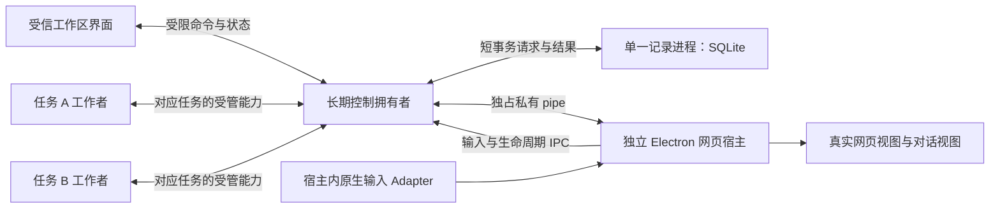

# 工程技术栈评审记录

2026-10-14，用户明确要求：“我希望从工程化的各个角度慎重的考虑技术栈选型”，并调用 `grill-with-docs`。本轮已完成访谈、查证和 Q18 整体确认。用户随后要求先提交技术选型规划、暂停代码实现；原型确认与事项 01 的目标仍有效。

[集中工程方案](engineering-stack-proposal.md)已按本轮答案收束。它最初只是候选，此前“采用推荐组合／比较 React 与 Vue”的单一选择题已由本轮全面评审取代；不能将未回答、默认选项或已经写过候选代码当作选型批准。

## 已有约束与证据边界

- 当前 Mac 自用先行；其它平台后续凭证据支持。正式对外使用前签名、公证；首版检查新版并手动安装。
- 真实网页为主、每项任务独立对话；最多两项自动推进，停止、接管和结果归属对应任务。
- 已选择 Electron／Playwright／私有控制连接，以及单一持久记录拥有者／SQLite。依据在 [ADR](../../docs/adr/) 和 [实现规格](../helpr-first-release/spec.md)。评审核对其工程代价；如有新证据冲突，明确指出受影响的 ADR 后再讨论修订。
- 特定网站流程在运行时形成；代码只提供通用能力。界面展示不授予任务执行资格，UI 框架不能充当持久事实来源。
- 原型和有界实验是限定证据；当前候选代码不是验收通过。三组公开测试入口沿用已有确认。

## 决策树

按依赖分轮讨论。某分支的事实仍在核查时，不让用户猜技术能力，也不提前作下游决定。

| 节点 | 决定什么 | 前置与核查 |
| --- | --- | --- |
| R1 维护方式 | AI、人类维护者、既有技术偏好及交接要求 | 用户回答；代码库只能提供已有工程经验的线索，不能推定用户能力 |
| R2 优化顺序 | 长期维护与验证投入、首包速度、实际交付期限 | 用户回答；既定正确性、安全和恢复要求是约束 |
| R3 依赖与自研 | 通用工具采用原则、商业许可适配、自有工具维护责任 | 用户回答；具体工具的维护状态与许可由 agent 查证 |
| A 语言与边界 | TypeScript／JavaScript 范围、静态类型与运行时校验、共享契约 | R1、R2；跨进程和不可信输入不能仅靠编译类型 |
| B 界面与状态 | React／Vue 等、界面状态与持久事实的关系、样式、可访问组件、输入焦点 | R1–R3、界面工具事实；已批准视觉与交互是约束 |
| C 进程与执行 | 控制拥有者、网页宿主、工作者生存期、IPC、能力收口、原生组件边界 | A、现有隔离和生命周期证据；不向 UI 或模型暴露通用控制通道 |
| D 数据与演进 | SQLite 绑定、SQL／查询工具、迁移、数据版本、备份与凭据分离 | R2、R3、A、C、存储事实；核对实际嵌入的 Node 与原生 ABI |
| E 构建与分发 | 编译工具、Forge／builder／Packager、ASAR、fuses、签名、打包后的路径和进程身份 | R2、R3、A、C、D、交付工具事实；本机调试通过不能代替安装包 |
| F 日常质量门槛 | 格式与静态检查、三组公开入口的回归、UI／实包检查、CI 与本机职责、可重复构建 | R1、R2、A–E；明确每类证据能证明什么 |
| G 运行诊断与隐私 | 本机结构化日志、任务关联、脱敏、故障导出、是否使用远程诊断服务 | C、D、R2、R3；普通日志不收集密钥或完整敏感网页资料 |
| H 性能与资源 | 启动和交互响应、两页并行资源、历史规模、可测预算与性能回归 | B–E、实际环境基线；网页成本、宿主 UI 和模型时延分别观察 |
| I 依赖长期维护 | 版本支持周期、锁定和升级、许可证、漏洞处理、第三方内部协议与替换代价 | R3、A–H；固定版本不等于永不更新 |
| J 模型与通用工具 | 模型客户端与协议适配、流式响应、超时／取消／用量、素材解析及定时工具的采用边界 | A、C、既定模型与素材需求；工具库不接管执行授权、恢复判定或业务流程 |
| K 工程组织 | 模块和导入方向、包管理、开发入口、配置与秘钥边界、能由 AI 重复执行的检查 | A、C、E、F、I；不为每个进程或模块自动拆成独立发布包 |
| L 收束 | 明确选定／拒绝方案、验证缺口、实现顺序和重新考虑的触发条件 | 全部分支有答案，用户确认共同理解；必要决定记 ADR |

## 第一轮：维护与取舍

- **Q1 已回答**：用户原话“由 AI 进行维护，人类只负责实测、验收。”据此以 AI 持续维护为目标，重视机器可检查的契约、明确的错误位置、可重复验证和可恢复的修改；不把人的框架熟悉度或尚未证实的“AI 更熟悉某框架”当作选型依据。原问题中由普通开发者接手的设想不作为用户要求。
- **Q2 已回答**：用户选择“维护与验证优先”。在既定正确性、安全和恢复要求内，优先方便长期修改、排错和升级，接受有当前需要的前期投入，避免为假想规模建设。用户没有提出固定交付日期，不据此推定时间无限。
- **Q3 已回答**：用户选择“成熟工具优先，必要处自研”。通用能力优先采用仍在维护且许可适合后续商业使用的工具；确实妨碍 helpr 要求时才自研，记录原因和维护责任。依赖数量不是单独的优化目标。

这三项是已确认的选型原则，不等于批准任何具体库。第二轮已经据此确认 A（语言与契约）及 B 中的界面框架；状态组织、物理进程边界、具体版本和发布验证分别讨论。

## 事实调查

- 仓库和既有实验：已确认硬约束、未选择维度、候选假设、旧版工程参考的实际范围。
- 宿主界面：React／Vue／必要的其它候选在类型、组件、输入、可访问性和检查上的真实差异。
- 交付与数据：Forge、builder、Packager 的职责及维护成本；内置 SQLite 与其它绑定的条件；原生组件和签名相关边界。

事实与来源在调查返回后记录，尚未得到的内容保持待核查。基础工程术语不写进产品 `GLOSSARY.md`；只有真实形成的领域概念才按领域建模规则更新。

### 仓库调查：已返回

- 当前 [package.json](../../package.json) 沿用 npm、Node ≥24，新增候选依赖为 Electron 44.7.0、Playwright 1.64.0、fuses 2.1.3，尚无正式 TypeScript 或 UI 框架配置。
- 现有 [CI](../../.github/workflows/check.yml) 在 Ubuntu／Node 24 运行已保存证据、夹具与 Chromium 检查；没有 macOS 正式安装包检查。不能把现有检查数量当成产品检查完整性。
- 旧版 `/Users/yuexiaoliang/projects/flowpolit/package.json` 配置过 pnpm workspace、TypeScript、React 相关依赖、Vite、Packager 和 Prettier。这只提供可参考的工程配置，不证明新版适配，也不证明用户或未来维护者熟悉它们。
- 草案中“目前没有团队框架约束”缺少依据，已修正为待核定。React 的选择须与 Vue 等按实际维护条件比较。
- 当前候选 `.mjs/.cjs` 尚未形成完整应用：构建／实包验证命令及宿主入口引用的部分文件尚不存在。记录层和桌面 URL 策略等边界仍待审查。它们可以调整，不构成要求延续原选择的沉没成本。
- 除框架外，尚缺协议运行时校验与版本、迁移和降级保护、原生组件工具链、诊断脱敏、macOS 实包检查、依赖升级和量化性能目标。上述内容已经列入决策树。

### 界面与契约调查：2026-10-14

| 方面 | 已查证事实 | 对本项目的含义（工程判断） |
| --- | --- | --- |
| 类型检查 | React 的 TSX 使用 TypeScript 检查；Vue 单文件组件的模板检查由 `vue-tsc` 提供。Vite 构建不能代替独立类型检查。[React](https://react.dev/learn/typescript)、[Vue](https://vuejs.org/guide/typescript/overview) | 两者都可自动检查。React 少一个模板检查层，不能因此断言 AI 修复更可靠。 |
| 状态 | React 支持 reducer；Vue 可通过 `shallowRef` 接入外部不可变状态。两者的组件状态都不是跨进程持久事实。[React](https://react.dev/reference/react/useReducer)、[Vue](https://vuejs.org/guide/extras/reactivity-in-depth#integration-with-external-state-systems) | 状态转换和任务身份的正确性应在框架外有明确契约；不会因选用框架自动得到。具体状态库与拥有者在后续讨论。 |
| 输入与草稿 | React 受控输入需要及时回写并保持节点身份；Vue 的 `v-model` 默认在输入法拼字期间不更新。[React 输入](https://react.dev/reference/react-dom/components/input)、[Vue 输入](https://vuejs.org/guide/essentials/forms) | 都须检查中文候选确认、回车发送、粘贴、切换任务后的草稿与焦点；不能只靠模拟键盘认定真实 IME 通过。 |
| 可访问交互 | React Aria 与 Vue 的 Reka UI 均提供无样式的键盘、焦点、ARIA 等交互基础。[React Aria](https://react-aria.adobe.com/)、[Reka UI](https://reka-ui.com/docs/overview/introduction) | 可保留已确认外观，按需使用浮层、对话框等能力；不能替代 Electron 跨视图焦点验证。 |
| 组件验证 | React 上游弃用 `react-test-renderer` 并建议 Testing Library；Vue 官方推荐 Vitest／Vue Test Utils，并提示 Testing Library Vue 的 Suspense 限制。[React](https://react.dev/blog/2024/04/25/react-19-upgrade-guide)、[Vue](https://vuejs.org/guide/scaling-up/testing) | 固定一种与所选框架适配的组件检查入口，避免用快照测试代替任务归属和输入行为验证。具体检查工具留到 F。 |
| 样式 | Vite 支持 CSS Modules；Vue 支持 scoped CSS。[Vite](https://vite.dev/guide/features#css-modules)、[Vue](https://vuejs.org/api/sfc-css-features) | 均能隔离宿主组件样式并保留已确认视觉；网站自身样式不由宿主 UI 框架管理。 |

Svelte 也具备 TypeScript、检查和测试能力，但会另引入其编译与响应式语义。当前没有证明这一额外候选能更好满足 helpr 的具体要求，不展开完整三框架实现；也不把较小的 UI JavaScript 等同于双网页 Electron 内存更低。[Svelte TypeScript](https://svelte.dev/docs/svelte/typescript)、[迁移说明](https://svelte.dev/docs/svelte/v5-migration-guide)。

语言候选比较：推荐正式应用采用 TypeScript `strict`，另开启 `noUncheckedIndexedAccess` 与 `exactOptionalPropertyTypes`，而不是靠纯 JavaScript 的运行期错误暴露遗漏。代价是编译配置和受控处理编译器升级的新诊断；已有独立实验无需仅为一致性重写。[TypeScript strict](https://www.typescriptlang.org/tsconfig/strict.html)、[索引检查](https://www.typescriptlang.org/tsconfig/noUncheckedIndexedAccess.html)、[可选字段](https://www.typescriptlang.org/tsconfig/exactOptionalPropertyTypes.html)。

跨进程及模型等未知输入仍需要运行时校验。Zod 与 Valibot 都能由结构定义推导类型并返回结构化错误；Zod 内置 JSON Schema 转换，Valibot 通过官方单独转换包提供。推荐 Zod 是为了减少契约转换环节，不是声称其校验独有。两者都有不能导出的类型或转换；传输契约需限制为可序列化结构，转换失败显式报告。**格式正确不代表获得执行授权**。[Zod 基础](https://zod.dev/basics)、[Zod JSON Schema 限制](https://zod.dev/json-schema)、[Valibot 校验](https://valibot.dev/guides/parse-data/)、[Valibot JSON Schema](https://valibot.dev/guides/json-schema/)。

用户已选择 React，建议理由限于统一 TSX 检查入口、与无样式交互组件组合后可逐项定位检查结果；Vue 3 配合 `vue-tsc`、Reka UI 是成立的替代方案，不能说 React 被事实证明更优。React 的订阅清理、输入节点身份、任务切换状态须明确验证。如果为落实已确认交互需要大量补丁、绕过类型检查，或可访问组件不能满足实际行为，就重新比较 Vue。无需为了选框架重做完整视觉原型。

### 许可与维护状态：2026-10-14

本轮选定的 [TypeScript](https://github.com/microsoft/TypeScript/blob/main/LICENSE.txt) 和 [React Aria Components](https://github.com/adobe/react-spectrum/blob/main/LICENSE) 使用 Apache-2.0；[Zod](https://github.com/colinhacks/zod/blob/main/LICENSE) 和 [React](https://github.com/react/react/blob/main/LICENSE) 使用 MIT。备选的 [Vue](https://github.com/vuejs/core/blob/main/LICENSE) 与 [Reka UI](https://github.com/unovue/reka-ui/blob/main/LICENSE) 也使用 MIT。当前推荐的核心能力不要求购买商业许可证或付费解锁；交付保留版权、许可证和适用的 NOTICE 等文件，具体依赖清单在构建产物中核对。

官方发布记录表明上述项目目前仍有维护：[TypeScript 7.0.2](https://github.com/microsoft/TypeScript/releases/tag/v7.0.2)、[Zod 4.6.7](https://github.com/colinhacks/zod/releases/tag/v4.6.7)、[React 19.3.0](https://github.com/react/react/releases/tag/v19.3.0)、[React Aria Components 1.22.0](https://github.com/adobe/react-spectrum/releases/tag/react-aria-components%401.22.0)、[Vue 3.5.44](https://github.com/vuejs/core/releases/tag/v3.5.44)、[Reka UI 2.11.0](https://github.com/unovue/reka-ui/releases/tag/v2.11.0)。这是查证时的发布状态，**不是产品锁定版本或未来维护保证**。尤其 TypeScript 已出现新编译器发布线，选定工具不表示直接采用 Latest；组合兼容和升级政策在后续收束。

### 交付与存储调查：2026-10-14

- **Packager 只负责平台应用包的一部分工作。** 编译、开发编排、安装器、原生构建衔接及发布核对仍需组合；原草案的“少量衔接配置”低估了自有维护责任。[Packager](https://github.com/electron/packager)。
- **Forge 与 builder 都须纳入完整比较。** Forge 提供 package／make／publish 生命周期并使用 Packager；其 Vite 插件标为 experimental，但可以使用显式编译加 hooks 或其 Webpack 插件，不能因此排除 Forge。[Forge 生命周期](https://www.electronforge.io/core-concepts/build-lifecycle)、[Vite 插件](https://www.electronforge.io/config/plugins/vite)、[Webpack 插件](https://www.electronforge.io/config/plugins/webpack)。builder 也覆盖资源过滤、原生依赖、签名、公证和发布；需使用已发布 v26 的文档，不能把主站尚未发布的 v27 能力当成当前稳定能力。[builder v26](https://www.electron.build/v26/docs/features/build-lifecycle/)。
- **实际嵌入版本需要单独查证。** 已有 Electron 44.7.0 实验报告带 Node 24.21.0；该版本 `node:sqlite` 仍为 Stability 1.2（Release candidate），`DatabaseSync` 同步执行。开发机 Node 能通过记录测试，不证明实际包的兼容性或主线程响应。[对应 Node 源文档](https://raw.githubusercontent.com/nodejs/node/v24.21.0/doc/api/sqlite.md)。
- **不能沿用旧的原生绑定成本判断。** `better-sqlite3` 13.0.0 改用 N-API，上游说明其预构建产物理论上可跨 Node／Electron 版本使用；13.0.3 要求 Node ≥22。仍有原生二进制的打包、解包、签名和 SQLite 自身换版验证成本，但“每次 Electron 升级都要 ABI 重编译”不再是可直接套用的判断。[13.0.0](https://github.com/WiseLibs/better-sqlite3/releases/tag/v13.0.0)、[13.0.3](https://github.com/WiseLibs/better-sqlite3/releases/tag/v13.0.3)、[故障说明](https://raw.githubusercontent.com/WiseLibs/better-sqlite3/v13.0.3/docs/troubleshooting.md)。
- **安装包影响边界不能隐藏。** ASAR 是只读归档，数据库需在包外；原生二进制和可执行工作者需要明确路径及解包方案。Fuses 在签名前设置；禁用 RunAsNode 会影响 `child_process.fork`；`utilityProcess` 不直接提供现有私有 pipe 所需的 fd 3／4，不能不经验证直接替换宿主进程方式。[ASAR](https://www.electronjs.org/docs/latest/tutorial/asar-archives)、[Fuses](https://www.electronjs.org/docs/latest/tutorial/fuses)、[utilityProcess](https://www.electronjs.org/docs/latest/api/utility-process)、[原生模块](https://www.electronjs.org/docs/latest/tutorial/using-native-node-modules)。

### 既定私有连接路线的 API 证据：2026-10-14

已安装 Playwright 1.64.0 的 `connectOverCDP(transport, options)` 有公开导出的类型、实现和上游测试；官网 API 页未完整展示该重载，不能据此称为使用私有 `_` API。发布包声明可见 `experiments/visible-page-control/node_modules/playwright-core/types/types.d.ts` 的 `ConnectOverCDPTransport`，实际使用见[实验 worker](../helpr-first-release/experiments/private-browser-control/worker.mjs)。[上游实现](https://github.com/microsoft/playwright/blob/v1.64.0/packages/playwright-core/src/client/browserType.ts#L126)、[公开类型覆盖](https://github.com/microsoft/playwright/blob/v1.64.0/utils/generate_types/overrides.d.ts#L174)、[上游测试](https://github.com/microsoft/playwright/blob/v1.64.0/tests/library/chromium/connect-over-cdp.spec.ts#L811)。

transport 重载仅支持 Playwright 的 in-process driver；这不要求 Electron 宿主与调用者是同一进程，自有 IPC 可作为 transport。`noDefaults` 是官网记载的公开选项，避免对既有默认 context 应用一些覆盖，**不是权限隔离措施**。[noDefaults 与 CDP 限制](https://playwright.dev/docs/api/class-browsertype#browser-type-connect-over-cdp)。

本轮未发现推翻 ADR-0003 的事实依据。升级维护风险在于 Electron 的 Chromium、Playwright 发送的 CDP 行为与 helpr 自有能力转接三者组合；公开 API 不保证所有底层消息和顺序不变。版本升级需覆盖两任务、越权拒绝、导航／frame、接管、断连和真实包；具体门槛在 F／I 收束。

## 第二轮：代码契约与界面工具

- **Q4 已回答**：用户选择“采用 TypeScript＋Zod（推荐）”。正式应用使用严格类型检查与运行时边界校验；基础结构可共享，IPC、模型输出分别限定允许的消息，执行授权继续由既定拥有者判定。原生组件使用平台必需的语言，已有独立实验不强制重写。具体编译器及库版本另按组合兼容选择。
- **Q5 已回答**：用户选择“采用 React 组合（推荐）”。宿主界面采用 React、CSS Modules，按需使用 React Aria 的无样式交互能力，沿用已确认视觉及原型行为。构建工具、正式状态模型和测试套件在下游分别收束。

第二轮确认以上具体选型，不据此推定后续数据库绑定、打包、CI 或升级政策已经获准。完整工程方案仍需最终共同理解确认。

## 进程边界的比较依据

2026-10-14 只读核查发现：ADR-0004 要求单一持久记录拥有者，没有要求其与控制拥有者处于同一个 OS 进程。三组实验分别覆盖不同组合，不能把证据相加当成正式产品组合已经通过：

| 材料 | 实际布局 | 未覆盖内容 |
| --- | --- | --- |
| [私有控制](../helpr-first-release/experiments/private-browser-control/controller.mjs) | 独立 Node 控制拥有者持有 pipe；另有 Electron 网页宿主；每项任务有独立 Node 工作者 | 没有 SQLite 组合 |
| [持久记录](../helpr-first-release/experiments/durable-record-consistency/owner.mjs) | 独立 Node 记录拥有者、调用者及效果接收端 | 没有 Electron、真实网页和原生输入组合 |
| [封装生命周期](../helpr-first-release/experiments/macos-packaged-lifecycle/src/controller.mjs) | 控制 Electron 主进程同时承担 SQLite、Broker、协调及生命周期；另有 Electron 网页宿主；任务工作者为 utilityProcess | 没有慢磁盘、长历史和备份时的停止延迟证据 |
| 未提交的当前候选 `app/desktop/controller.mjs` | 控制进程同时持有记录模块和 Broker，观察者为 utilityProcess | 尚未完成网页宿主和正式包，不能形成沿用理由；候选不在本次规划提交中 |

`DatabaseSync` 是同步接口；Electron 建议避免主进程同步 I/O 和长工作。`utilityProcess` 提供独立 Node 环境、消息端口及退出通知，可由 Electron 主进程管理。[对应 Node 文档](https://raw.githubusercontent.com/nodejs/node/v24.21.0/doc/api/sqlite.md)、[Electron 性能建议](https://www.electronjs.org/docs/latest/tutorial/performance#3-blocking-the-main-process)、[utilityProcess](https://www.electronjs.org/docs/latest/api/utility-process)。

| 物理布局候选 | 收益 | 代价 |
| --- | --- | --- |
| 记录与控制放同一主进程 | 少一个 IPC 和生命周期，顺序直观，有局部封装证据 | 数据库同步、锁等待、迁移、备份会阻塞处理停止和控制消息的事件循环 |
| 单一记录拥有者放独立受管进程（已选） | 数据库停顿隔离于控制事件循环；可独立检验记录故障 | 增加进程、请求去重、背压、提交回执丢失、启动及退出处理；完整组合尚需验证 |

已选的职责分工如下。进程方案的确认不代表功能验收或实现完成：

此图展示职责与通信，不把一个 WebContentsView 等同于固定一个 OS renderer 进程。记录进程可以使用 utilityProcess；网页宿主仍按独占 pipe 的已选路线启动，不能把两者混成相同启动方式。

控制拥有者收到可信停止或接管后，先关闭内存派发入口并撤销旧资格，再请求记录进程保存。停止不排在普通数据库队列之后；旧预留与迟到回复仍需核对当前资格。记录超时或退出时暂停依赖该库的自动工作，保留“已经阻断”与“已经可靠保存”的区别；稳定请求身份用于核对提交回执丢失，不能盲目重发。记录进程不能接管 pipe，任务工作者也不能直接写任意表。

**反例不能照搬：**封装实验 `controller.mjs` 的 `pause()` 先同步 `UPDATE` 再 `broker.revoke()`，与正式规格“先阻断、再保存”的顺序不符。该样本成功不证明保存阻塞或失败时仍满足停止要求；正式实现以[规格](../helpr-first-release/spec.md#8-持久记录与派发协议)为准。本轮不修改已保存实验或把它改称正式产品缺陷已经修复。

原生输入实验采用 Objective-C++、C++17、Cocoa/AppKit 与 C Node-API 8，识别本应用窗口事件及视图归属。它必须处于能访问宿主窗口与 NSView 的主线程，不能移到记录进程；任务规则和数据继续使用 TypeScript。已有编译脚本尚未显式固定架构、SDK 和 deployment target，正式工具链需补齐；生产入口排除测试注入能力。[实验源文件](../helpr-first-release/experiments/macos-packaged-lifecycle/src/native/input-monitor.mm)、[实验构建](../helpr-first-release/experiments/macos-packaged-lifecycle/build.mjs)、[Apple 本地事件监视说明](https://developer.apple.com/library/archive/documentation/Cocoa/Conceptual/EventOverview/MonitoringEvents/MonitoringEvents.html)。

待取得的组合证据：独立记录进程的实际包兼容、慢提交和备份期间的停止响应、记录进程与控制拥有者退出的不同路径、提交回执丢失、进程树清理和资源占用。原生回调目前异步 IPC 报告输入，不能仅凭回调先于返回事件就认定控制端已先撤销资格；正式接管需要核对这一先后关系，不能以本次进程拆分自动宣称解决。

## 状态组织的初次比较（Q7 未接受暂缓状态库）

现有规格已要求分别保存用户意图、执行条件、参与请求、派发效果与展示状态。例如“已停止”和“先前发出的发布后来完成”可以同时成立；这项产品约定无需重新决定。本轮要选择如何组织实现和检查，不能压成一个包办全部含义的状态枚举。

| 候选能力 | 官方支持与限制 | 当前采用判断 |
| --- | --- | --- |
| React 自带能力 | `useSyncExternalStore` 订阅外部快照；快照须缓存且不可变。`useReducer` 适合局部纯转换，不在 reducer 内执行网页动作。[订阅](https://react.dev/reference/react/useSyncExternalStore)、[reducer](https://react.dev/reference/react/useReducer) | 推荐用于只读业务投影和局部交互。IPC 顺序、版本、缺口重取及持久化仍由 helpr 的边界负责。 |
| Zustand | 提供独立 store、订阅与选择性读取；`persist` 默认使用 localStorage，不会自动形成合格业务记录。[store](https://zustand.docs.pmnd.rs/reference/apis/create-store.html)、[persist](https://zustand.docs.pmnd.rs/reference/middlewares/persist.html) | 共享 UI 状态和订阅选择明显复杂时再引入；不能从界面缓存恢复执行资格。 |
| Redux Toolkit | 提供 reducer 组织、开发检查、DevTools 和副作用中间件；不自动提供 SQLite 与网页间的事务或中断恢复。[配置](https://redux.js.org/toolkit/api/configureStore)、[副作用](https://redux.js.org/usage/side-effects-approaches) | 跨界面事件追踪与调试有明确收益时重新考虑。当前不以全局 store 承担持久事实来源。 |
| XState | 提供层级／并行状态、actor 生命周期、异步编排，也支持纯转换；恢复 invocation 可能重新启动工作，快照随逻辑升级有兼容成本。[actors](https://stately.ai/docs/actors)、[持久化](https://stately.ai/docs/persistence)、[v5.19 纯转换](https://github.com/statelyai/xstate/releases/tag/xstate@5.19.0) | 转换结构和超时编排重复到难以审查时重新比较；不能直接用快照恢复重新发起发布。当前官网部分能力涉及 v6 alpha，不默认为稳定版可用。 |

XState 顶层 final 不能继续接受事件，停止 Promise actor 会丢弃之后的返回；即使传递取消信号也不证明网站没有完成写入。使用它仍要单独记录迟到效果和可继续的用户意图。[终态](https://stately.ai/docs/final-states)、[Promise 停止](https://stately.ai/docs/promise-actors#stopping-promise-actors)。这些是使用约束，不表示该库不能实现 helpr，也不是拒绝一切状态工具的理由。

初次建议（未被采用）是用框架外 TypeScript 判别联合与纯转换表达 helpr 的业务规则，暂不引入状态库。转换接受当前事实和命令／观察，产生新事实或拒绝原因；记录拥有者核对预期版本后统一提交，控制拥有者仍按持久预留、当下资格和停止状态派发。业务副作用不藏在 React effect 或状态转换函数中。`never` 等穷尽检查能发现遗漏分支，不能证明转换合法、记录已保存或外部效果未发生；检查从已确认的公开入口覆盖事件次序与结果。这些边界在采用状态库后仍需保留。[TypeScript 穷尽检查](https://www.typescriptlang.org/docs/handbook/2/narrowing.html#exhaustiveness-checking)。

界面取得带版本的只读投影，局部交互沿用 React 已有能力；跨重启保留的草稿另有明确的持久归属。任何一个候选库都可以只负责 UI 投影，选库本身不会必然产生第二事实源；错误来自界面自行认定已经继续／成功，或从旧缓存恢复后直接派发。推荐方案的代价是需要维护清晰转换规则与序列检查，暂没有额外状态工具提供的统一状态图与专用调试面板。

## 第三轮：物理进程与状态组织

- **Q6 已回答**：用户选择“采用独立记录进程（推荐）”。SQLite 记录、迁移和备份置于单一独立受管进程，控制拥有者保留内存资格、协调及私有网页控制；原生输入保留在网页宿主 Adapter。接受该方向不代表完整组合已经验证，特别是慢提交时的停止、回执丢失和异常退出。
- **Q7 已回答，需进一步选库**：用户选择“希望首版就采用成熟状态管理库”。原先暂不引入额外状态库的推荐未被接受，正式选型须包含一个能实际帮助状态管理的成熟库。唯一记录拥有者、意图与结果分别保存、界面不自行授予执行资格等既有约束保持；下一步比较 Redux Toolkit、Zustand、XState 的具体职责及组合成本，不能把“以后再引入”当成当前结论。

这两项分别依赖既有记录权威、已确认语言／界面与本轮事实，不互相预设答案。独立记录进程确认后，数据工具可以进入选择；状态工具的具体方案继续比较。上方暂缓状态库的建议仅保留为讨论经过，以本轮回答为当前要求。

## 数据工具比较与第四轮选择

2026-10-14 查询官方源码与发布资料。以下版本用于定位已查证能力，正式锁定仍须核对实际运行时和安装包；不把官网 RC 示例当成稳定版本能力。

- `node:sqlite` 在 Node 24.21.0 提供参数绑定与在线 `backup()`，事务用 SQL 管理。优点是随 Electron 分发；API 与 SQLite 修正也随内嵌 Node／Electron 演进，当前 API 仍为 Release candidate。[对应版本文档](https://raw.githubusercontent.com/nodejs/node/v24.21.0/doc/api/sqlite.md)。
- `better-sqlite3` 13.0.3 提供同步查询、事务函数、嵌套 savepoint 及在线备份，事务函数不能跨 `await`。13 系 N-API 路线是新变化，不能直接沿用旧版全部兼容经验；仍需实际 arm64 二进制、ASAR、签名和包内加载证据。[API](https://raw.githubusercontent.com/WiseLibs/better-sqlite3/v13.0.3/docs/api.md)、[N-API 变更](https://github.com/WiseLibs/better-sqlite3/releases/tag/v13.0.0)。
- 两者在线备份只复制数据库，素材和证据文件的一致性仍须 helpr 按既定协议协调；数据库事务不包含网页效果。

| 查询／迁移方案 | 得到的能力 | 需要承担的成本 |
| --- | --- | --- |
| 参数化 SQL＋自行维护迁移管理 | SQL 明确，驱动适配直接 | TypeScript 不检查 SQL 字符串的表列；类型、迁移历史、失败恢复和完整性规则需自行维护，依赖少不等于维护少 |
| Kysely 0.29.6＋better-sqlite3 | 类型化查询、列与返回结构，内置 SQLite 方言与 Migrator | 表类型须与真实库同步；迁移手写并冻结；该版本 SQLite Migrator 不自动用事务包住迁移，通过 `error/results` 报告错误，不能只等抛错 |
| Drizzle ORM 0.45.4＋Kit 0.31.11＋better-sqlite3 | TS schema、类型化查询、生成可审查 SQL 与运行时迁移；同步迁移器把待迁移 SQL 和迁移记录置于事务 | 维护 schema、SQL 和迁移快照一致；复杂数据转换仍需专门处理。官网新 `node:sqlite` 路线要求 RC，稳定包未导出此驱动 |

来源：[Kysely 类型边界](https://kysely.dev/docs/recipes/data-types)、[迁移](https://kysely.dev/docs/migrations)、[SQLite adapter](https://raw.githubusercontent.com/kysely-org/kysely/v0.29.6/src/dialect/sqlite/sqlite-adapter.ts)、[Migrator](https://raw.githubusercontent.com/kysely-org/kysely/v0.29.6/src/migration/migrator.ts)、[Drizzle 迁移](https://orm.drizzle.team/docs/migrations)、[驱动指引](https://orm.drizzle.team/docs/sqlite/get-started-sqlite)、[稳定版本迁移实现](https://raw.githubusercontent.com/drizzle-team/drizzle-orm/0.45.4/drizzle-orm/src/sqlite-core/dialect.ts)。

可决策的组合是 better-sqlite3＋Drizzle、better-sqlite3＋Kysely，或 node:sqlite＋显式 SQL／迁移管理。前者应证明生成迁移可审查、可中断恢复；中者应计算补齐 SQLite 迁移保护的维护成本；后者必须明确承担 RC 与自有迁移管理成本，不能仅因旧实验已经使用就默认采用。所有组合仍需要预期版本、请求去重、Zod 边界校验及真实历史库验证。

Node 核心、better-sqlite3、Kysely、Drizzle Kit 为 MIT；Drizzle ORM 为 Apache-2.0；SQLite 为公有领域。交付仍保留实际依赖的第三方声明：[Node](https://raw.githubusercontent.com/nodejs/node/v24.21.0/LICENSE)、[better-sqlite3](https://raw.githubusercontent.com/WiseLibs/better-sqlite3/v13.0.3/LICENSE)、[Kysely](https://raw.githubusercontent.com/kysely-org/kysely/master/LICENSE)、[Drizzle](https://raw.githubusercontent.com/drizzle-team/drizzle-orm/main/LICENSE)、[Kit 元数据](https://registry.npmjs.org/drizzle-kit/latest)、[SQLite](https://sqlite.org/copyright.html)。

- **Q8 已回答**：用户选择“采用 better-sqlite3＋Drizzle（推荐）”。正式数据层采用 better-sqlite3 与 Drizzle ORM／Kit 的稳定发布版本，在独立记录进程中运行；维护可审查、冻结的迁移文件和历史库恢复检查。实际版本需核对 Node／Electron、原生二进制与包内路径；不能直接使用开发结构同步命令修改用户资料，亦不因选择工具而认为迁移已验收。

Q8 依赖已确认的进程边界，不依赖尚在比较的状态库；状态库必须接入同一个记录权威，不另建持久事实来源。构建与分发分支现可继续比较。

## 第五轮：首版采用的状态库

用户要求首版采用成熟库后，比较转向能实际组织业务转换的方案：

| 候选 | 实际贡献与代价 |
| --- | --- |
| XState 稳定 5.x（已选） | 提供层级、并行状态、guards 和明确转换，直接对应停止、接管、参与、迟到和恢复的关系；需维护状态图、业务数据版本及恢复边界 |
| Redux Toolkit | `createSlice`、Immer、序列化检查、selectors 和 DevTools 统一 reducers 与事件追踪，不仅能做 UI 缓存；合法转换和层级／并行关系仍需自行组织，官方也建议把 reducer 写成状态机 |
| Zustand | 简洁的共享 UI 状态、快照与选择订阅；业务转换约束仍需自行组织，不能仅替换界面 store 就认定已解决核心状态维护 |

调查时可核实的稳定发布为 [XState 5.33.2](https://github.com/statelyai/xstate/releases/tag/xstate@5.33.2)、[Redux Toolkit 2.13.0](https://github.com/reduxjs/redux-toolkit/releases/tag/v2.13.0)、[Zustand 5.0.15](https://github.com/pmndrs/zustand/releases/tag/v5.0.15)。版本引用用于定位事实，不代替产品锁定。XState 文档有 v6 alpha 内容，选型采用稳定 5.x 的实际能力；RTK 对 TS 7 的支持需以对应发布说明为准。[RTK 状态机建议](https://redux.js.org/style-guide/#treat-reducers-as-state-machines)、[XState TypeScript](https://stately.ai/docs/typescript)。

- **Q9 已回答**：用户选择“采用 XState 稳定版（推荐）”。XState 在唯一记录拥有者内管理通用任务生命周期与业务转换，界面订阅结果，局部交互继续使用 React；首版不同时叠加第二个全局状态库。这里指选择一种状态库，各任务仍独立建模，不把所有任务和事实挤入一个巨大状态机。网站步骤仍为结构化运行时流程数据。

采用的工程边界：

1. 稳定版的 `transition`／`initialTransition` 计算下一快照和动作但不执行动作。校验命令及版本后计算转换，同一事务保存相关事实与动作预留，再由控制拥有者经过当前资格检查派发；停止保持先阻断后保存的既有顺序。[稳定源码](https://github.com/statelyai/xstate/blob/xstate@5.33.2/packages/core/src/transition.ts)。
2. XState 原始 actions 可能含 `exec`、actor 引用等，不能直接作为 JSON／SQLite／IPC 契约。仅提取允许的业务命令及参数并经 Zod 校验；计时和异步操作由统一机制处理，不声称纯转换自动运行它们。[类型定义](https://github.com/statelyai/xstate/blob/xstate@5.33.2/packages/core/src/types.ts)。
3. 业务事实与模型版本可迁移；恢复先核对，不直接 `createActor({snapshot}).start()` 重启发布 invocation。用户停止不设为禁止继续事件的顶层 final，迟到结果仍能登记。[恢复限制](https://stately.ai/docs/persistence)。
4. React 不另运行一份业务机。可使用 React 自带订阅；如采用 `@xstate/react` 的 `useSelector` 接只读投影，须核对公开订阅接口与实际包组合。该适配仍待验证，不因此额外引入 UI 全局 store。[6.1.0 公开实现](https://github.com/statelyai/xstate/blob/@xstate/react@6.1.0/packages/xstate-react/src/useSelector.ts)。

三者核心均为 MIT，运行时无购买云服务的前置条件：[XState](https://github.com/statelyai/xstate/blob/main/LICENSE)、[RTK](https://github.com/reduxjs/redux-toolkit/blob/master/LICENSE)、[Zustand](https://github.com/pmndrs/zustand/blob/main/LICENSE)。本机可读的事件、转换前后和命令轨迹应可独立检查。XState 的图形 Inspector 默认使用 Stately 托管页面，Studio 有付费套餐；不将它写成必需的离线或免费工程能力，也不默认向其发送业务状态。[Inspector](https://stately.ai/docs/inspector)、[客户端](https://github.com/statelyai/inspect)、[套餐](https://stately.ai/pricing)。

落地时在对应已确认原型范围内验证停止后迟到成功、旧回复失效、保存失败、重开核对及双任务隔离。若状态图主要成为大量 context 修改、关键转换仍散落在外部条件，重新评估 XState 的收益，备选为 RTK 管理 reducers 与投影。这个反转条件不等于本轮已经运行技术原型或授予新的实验额度。

## 构建、通信与诊断的比较依据

### 完整构建路线

已查证的发布线为 electron-builder 26.15.3、electron-vite 5.0.0、Forge 8.0.1，均为 MIT；只是调查兼容候选，未锁定为实际产品版本。Builder 主站包含未发布 v27 信息，本次以 [v26 文档](https://www.electron.build/v26/docs/configuration/)为准。

| 路线 | 收益与维护成本 |
| --- | --- |
| electron-builder 稳定 v26＋electron-vite 稳定版（推荐） | 前者负责生产依赖、ASAR、原生重建、fuses、签名公证和安装产物，后者组织 TS／React 开发与编译。明确配置多进程入口及资源，原生依赖保留 external，由打包器收集。 |
| Forge 8＋Webpack 稳定插件 | 开发、编译、重建与 package／make／publish 一体化，是成立的替代。插件源码保留对象形式的 main 多入口；原生依赖通常经 node-loader 与其固定版本的 asset-relocator，需要联验。 |
| Forge＋独立 Vite／TS 编译 | 可绕开 Forge 实验性 Vite 插件，但需编排开发启动、watch、编译顺序和产物，当前缺少减少胶水维护的直接理由。 |
| Packager＋自行编排 | 可生成平台包，但整套构建、原生组件和分发生命周期由自己组织，仅在现成路线确有阻碍时再选。 |

来源：[Builder 生命周期](https://www.electron.build/v26/docs/features/build-lifecycle/)、[Forge 生命周期](https://www.electronforge.io/core-concepts/build-lifecycle)、[Webpack 插件](https://www.electronforge.io/config/plugins/webpack)、[Forge 多入口源码](https://github.com/electron/forge/blob/v8.0.1/packages/plugin/webpack/src/WebpackConfig.ts#L204-L244)。

推荐组合的限制必须落实到配置与包内检查：

- electron-vite 正式记录 utilityProcess 与 worker 支持，但 v5 的 `?modulePath` 默认走标为 experimental 的 Isolated Build。当前候选以普通 `rollupOptions.input` 命名入口和固定产物路径构建 controller、host、records 和 workers，不使用 `isolatedEntries`。多个 sandbox preload 各自完整打包为独立 CJS，不能共享一个会再次 `require` 外部 JS 依赖的产物。[进程支持](https://electron-vite.org/guide/dev#utility-process-and-child-process)、[隔离构建](https://electron-vite.org/guide/isolated-build)。
- main/preload 的生产依赖默认 external；原生依赖适合外置收集，sandbox preload 的 JS 依赖则需打进自身。不能通过关闭 sandbox 或照抄 `npmRebuild:false` 来绕过问题。[依赖处理](https://electron-vite.org/guide/dependency-handling)、[原生重建配置](https://www.electron.build/v26/docs/configuration/#nativerebuilder)。
- Forge Webpack 默认只把 `.webpack` 纳入包并创建空 `node_modules`；仅设置 external 不意味着原生依赖自动进入产物。需采用官方 relocation 路线或明确的复制配置；它重写 package.json 不等于删除 dependencies。[打包源码](https://github.com/electron/forge/blob/v8.0.1/packages/plugin/webpack/src/WebpackPlugin.ts#L613-L683)。
- 原生输入组件使用本地 Node-API 包、`binding.gyp` 与 node-gyp。GYP 支持 `.mm`；相较手写 clang，成熟工具组织目标头文件、架构和增量编译，仍要固定 SDK、deployment target、arm64 及签名条件。[node-gyp](https://github.com/nodejs/node-gyp#build-for-third-party-nodejs-runtimes)、[Objective-C++ 支持](https://github.com/nodejs/gyp-next/blob/main/pylib/gyp/generator/make.py)。
- 网页宿主的 fd 3／4 与异常退出协议由 helpr 明确实现，多入口编译不证明它们正确。检查迁移文件和全部依赖确实入包、移动 `.app` 后路径正确、原生模块按需 unpack、业务资料位于包外；配置 `allowMissingDependencies:false`，不能把缺依赖警告当成功。设置 fuses 后签名，签名后不改包；本人自用与正式签名公证分别取证。Builder 不要求开启自动下载安装，既定首版范围不变。[Builder 顺序](https://www.electron.build/v26/docs/features/build-lifecycle/)、[ASAR](https://electron-vite.org/guide/distribution)。

反转条件：若入口和 preload 配置变成大量自制开发工具，或升级必须依赖实验性能力，优先重新比较 Forge＋Webpack。不能由文档支持直接声称真实包已经通过。

### 进程通信

推荐 Electron 原生 `contextBridge`、`invoke/handle`、受管进程消息和必要的 MessagePort，外加 Zod 校验的固定业务协议。Electron 已提供运输能力；MessagePortMain 与浏览器端接口有差异，端口经 `postMessage` 转移。[IPC](https://www.electronjs.org/docs/latest/tutorial/ipc)、[MessagePort](https://www.electronjs.org/docs/latest/tutorial/message-ports)、[utilityProcess](https://www.electronjs.org/docs/latest/api/utility-process)。

协议薄层明确协议版本、请求身份、任务／执行／代际、结构化错误、大小上限、超时和断线处理。发送 frame 及角色来自创建通道时的可信绑定，不信任消息自报；Zod 不替代身份和当前资格检查。超时不能解释成动作未发生，迟到成功也不能解除后来发生的停止。[发送方校验](https://www.electronjs.org/docs/latest/tutorial/security#17-validate-the-sender-of-all-ipc-messages)。

tRPC 的官方适配器没有直接列 Electron IPC，需要社区或自有适配，增加路由／链接层；Comlink 用 Proxy 访问远端对象，也需适配 Electron 端点和生命周期。两者能减少某些调用代码，但不能省去上述业务约束；当前固定能力入口尚不足以证明额外层次的收益，不建设通用对象远程调用框架。[tRPC adapters](https://trpc.io/docs/server/adapters)、[Comlink](https://github.com/GoogleChromeLabs/comlink)。

### 本机诊断

推荐 Pino 的结构化 JSON、关联字段和路径脱敏，配合 pino-roll 的容量／数量限制及异步文件流；每个受管进程独占文件，可信界面仅经窄桥上报限定事件。默认仅本机，主动导出脱敏诊断；任务历史、素材和必要证据仍按原保留约定管理，不以诊断轮转删除。[字段绑定](https://github.com/pinojs/pino/blob/main/docs/child-loggers.md)、[异步](https://github.com/pinojs/pino/blob/main/docs/asynchronous.md)、[轮转](https://github.com/mcollina/pino-roll)。

Pino 的 transport worker 需要额外打包资源；pino-roll 也支持直接创建文件流。选择直接异步流或 worker 时要测实际停止响应及包内路径，不宣称所有配置都不阻塞。[Pino 打包](https://github.com/pinojs/pino/blob/main/docs/bundling.md)。日志只接受事件名、关联 ID、错误码、耗时等白名单字段；不直接序列化完整业务对象、原始 IPC 或任意异常字符串，路径脱敏无法清除字符串里所有秘密。[脱敏边界](https://github.com/pinojs/pino/blob/main/docs/redaction.md)。

electron-log 是成立的备选，Electron 集成、文件轮转及错误捕获更直接，无运行依赖；但默认同步写入，异步配置下轮转仍有同步文件操作，JSON 字段契约和脱敏需要自设，utilityProcess 日志也需显式转发。当前 Pino 对 AI 按任务、执行和进程定位问题更直接。[文件配置](https://github.com/megahertz/electron-log/blob/master/docs/transports/file.md)、[实现](https://github.com/megahertz/electron-log/blob/master/src/node/transports/file/index.js)、[utility 转发](https://github.com/megahertz/electron-log/blob/master/docs/utility.md)。

异步日志的尾部可能随硬崩溃丢失；监督进程记录退出也不能使诊断日志替代 SQLite 的恢复事实。写入失败、轮转、退出和敏感字段处理须验证。本轮不引入云遥测或托管图形状态检查。Pino、pino-roll、electron-log、tRPC 为 MIT，Comlink 为 Apache-2.0；正式依赖清单核对其实际许可证。

## 第六轮：构建、通信与诊断

- **Q10 已回答**：用户选择“采用 electron-vite＋electron-builder（推荐）”。采用稳定发布、显式多入口和独立 preload 构建，原生模块以 node-gyp 管理；避开实验性隔离构建。Forge＋Webpack 保留为配置成本失控时的备选。实际版本与包内组合仍需核对；首版检查新版与手动安装范围不变。
- **Q11 已回答**：用户选择“采用原生通信＋业务契约（推荐）”。Electron 原生通信配合 Zod 固定命令，真实发送方、任务／执行／版本、超时和迟到处理明确化；首版不再增加通用 RPC 框架。
- **Q12 已回答**：用户选择“采用 Pino 本机诊断（推荐）”。采用 Pino＋pino-roll 的本机结构化诊断、有界轮转、限定字段与主动导出，默认不接云端错误收集；业务历史与恢复事实按既定规则保存。分享或导出界面仍按对应功能原型流程确认，选型不等于额外界面已经获准实现。

## 第七轮：模型客户端

- **Q13 已回答**：用户选择“采用 AI SDK Core＋直连适配器（推荐）”。SDK 负责请求编码、流式与结构解析；helpr 负责归属、资格、预算、取消、实际尝试和用量。显式创建直连 provider，已验证的 DeepSeek 协议和可配置 Chat Completions 协议各有适配；不通过字符串模型名默认选择 Gateway，不引入 SDK 的自主网页执行循环。正式支持范围以实际能力验证为准。

比较依据：OpenAI SDK＋`baseURL` 也是成熟的 OpenAI 协议客户端，改地址不能自动适配其它提供方所有字段和能力；现有小型 fetch 实验保留为取消、无重试与脱敏的参照，但继续自行维护流式工具参数、reasoning 和协议差异成本较高。AI SDK 的统一接口减少这些适配工作，同时带来升级时复核默认行为的责任。[兼容 provider](https://ai-sdk.dev/providers/openai-compatible-providers)、[OpenAI 官方客户端](https://developers.openai.com/api/reference/typescript)、[既有实验](../helpr-first-release/experiments/model-api/REPORT.md)。

调查版本为 `ai` 7.0.140、DeepSeek provider 3.0.64、compatible provider 3.0.68，要求 Node ≥22，支持 Zod `^3.25.76 || ^4.1.8`；OpenAI SDK 对比版本为 7.33.0。均为 Apache-2.0，直连不要求购买 Vercel 服务。实际组合版本仍待锁定。[AI SDK 元数据](https://registry.npmjs.org/ai/7.0.140)、[OpenAI SDK 元数据](https://registry.npmjs.org/openai/7.33.0)、[AI SDK 许可证](https://github.com/vercel/ai/blob/ai%407.0.140/LICENSE)。

已查明的必要约束：

- 设置 `maxRetries: 0`；当前 v7 省略 `streamRetries` 才禁用全部流内恢复，显式 `0` 仍允许 `onError` 请求一次重试，因此不得返回 `retry:true`。任何再次发送都需 helpr 重新核对并独立记账。[流式参数](https://ai-sdk.dev/docs/reference/ai-sdk-core/stream-text)。
- 显式单步，不提供网页工具 `execute`，不用 ToolLoopAgent。生命周期通知会吞掉回调异常，不能仅在 `onStepStart` 中抛错充当预算或保存闸门；受控调用入口与实际发送前都须检查。[通知源码](https://github.com/vercel/ai/blob/ai%407.0.140/packages/ai/src/util/notify.ts)。
- DeepSeek provider 在 usage 对象存在但 token 字段缺失时可能补零，SDK 累计值也可能丢失未知区别。核对原始 `usage.raw` 的完整性，单独保留未知；中断或取消不证明服务端已停止计费。[usage 转换](https://github.com/vercel/ai/blob/ai%407.0.140/packages/deepseek/src/chat/convert-to-deepseek-usage.ts)。
- 原实验验证 JSON 模式＋本地校验，不等于服务端严格 schema。服务能力逐项核对，提议最终经 Zod，解析失败仍计入调用。[DeepSeek JSON 模式](https://api-docs.deepseek.com/guides/json_mode/)。
- 显式配置服务、协议、总时限、首段及段间时限与取消，关闭内容 telemetry。以本机模拟服务验证实际请求数、流中断、迟到、缺失 usage、结构错误和脱敏，再按既定范围验证真实服务。[provider 管理](https://ai-sdk.dev/docs/ai-sdk-core/provider-management)、[telemetry](https://ai-sdk.dev/docs/ai-sdk-core/telemetry)。

本轮未读取真实凭据或调用模型，选择 SDK 不代表上述组合已经通过。

## 日常工程与质量门槛依据

推荐正式产品使用 Vitest＋React Testing Library；类型化 ESLint、React Hooks 规则与 Prettier。旧实验的 node:test 保留。Node runner 本身成熟，Node 24 的类型擦除也不代表不支持 TS，但它不读取 tsconfig、不检查类型、不支持 TSX；统一正式产品的 Vitest 管线便于复用 Vite，仍须独立类型检查。[Node TypeScript](https://nodejs.org/docs/latest-v24.x/api/typescript.html)、[Testing Library 接入](https://testing-library.com/docs/react-testing-library/setup/#auto-cleanup-in-vitest)。

检查沿用已确认的三组公开入口：

| 范围 | 证据与局限 |
| --- | --- |
| 意图、记录与派发 | Vitest Node 环境，真实 better-sqlite3、临时资料、独立进程重开与独立效果计数。原生模块采用 forks 隔离；不以 mock 数据库代替持久化。宿主 Node 通过不代表 Electron 内嵌运行时通过。 |
| 网页工作区、执行与流程 | Testing Library 核对用户可见行为和任务归属；需要真实布局、焦点和键盘导航时用 Browser Mode／Playwright 或现有夹具。jsdom、普通 Chromium 与真人输入法、原生接管分别记证据。 |
| 应用运行、版本与恢复 | 正常启动最终产物，经原有受限公开入口操作，独立观察文件、请求、进程和实际结果；包含 utilityProcess、ASAR、原生组件、身份与升级。 |

来源：[Vitest 原生模块](https://vitest.dev/guide/common-errors#segfaults-and-native-code-errors)、[测试环境](https://vitest.dev/guide/environment)、[Browser Mode](https://vitest.dev/guide/browser/)。

**Playwright `_electron` 不作为最终安装包验收入口。** 官方仍标 experimental；1.64.0 启动源码加入 `--inspect=0` 和 `--remote-debugging-port=0`，官方说明禁用 `EnableNodeCliInspectArguments` 会影响启动。直接冲突是 inspect／调试能力，没有依据称它必需 RunAsNode。不能为测试重开正式包调试入口，开发模式通过也不能代替最终包。[官方说明](https://playwright.dev/docs/api/class-electron)、[启动源码](https://github.com/microsoft/playwright/blob/v1.64.0/packages/playwright-core/src/server/electron/electron.ts#L180-L220)。

静态检查使用成熟规则：typescript-eslint 的类型化规则、`no-floating-promises`／`no-misused-promises`，React 官方 Hooks 规则；Prettier 只负责格式。`void promise` 不等于错误已处理，关键保存和派发显式处理失败。跨层导入可用 `eslint-plugin-boundaries`，覆盖已配置的别名和公开入口；不把静态导入限制当运行时权限边界。[类型化 lint](https://typescript-eslint.io/getting-started/typed-linting/)、[Promise](https://typescript-eslint.io/rules/no-floating-promises/)、[React Hooks](https://react.dev/reference/eslint-plugin-react-hooks)、[Prettier](https://prettier.io/docs/comparison)、[模块边界](https://www.jsboundaries.dev/docs/settings/)。

Biome 已支持 Hooks 和限制导入，不能说只有格式化能力；但其关键 Promise 类型规则目前仍为 nursery／experimental，因此不作为唯一异步检查。引入 Biome 后同时保留类型化 ESLint 会增加两套配置，当前没有明确收益。[Biome Promise](https://biomejs.dev/linter/rules/no-floating-promises/javascript/)、[Promise 误用](https://biomejs.dev/linter/rules/no-misused-promises/javascript/)。

### 工程组织与现场

初轮曾建议一个应用、一个 npm 锁文件，按进程和职责分目录，本地原生组件需要包清单时使用小型 npm workspace。用户追问 pnpm 后，下方“包管理补充比较”重新核对 Builder 的真实收集能力与多检出目录的收益，当前推荐已改为 pnpm；本段不再代表最终推荐。Turbo 提供任务图和缓存，当前没有多项目独立构建需求或耗时证据支持引入；未来采用也不能缓存真人验收、真实业务写入或包内运行结果。[npm workspaces](https://docs.npmjs.com/cli/v11/using-npm/workspaces/)、[pnpm 当前构建设置](https://pnpm.io/settings/build)、[Turbo 缓存](https://turborepo.dev/docs/crafting-your-repository/caching)。

本机只读结果：macOS 14.8.3、arm64、16 GiB，宿主 Node 24.18.0、npm 11.16.0、Python 3.9.6、CLT 16.2／Apple clang 16，未检测到完整 Xcode。既有 Electron 内嵌 Node 24.21.0，与宿主分别记录。当前 CI 只有 Ubuntu 的旧实验和网页夹具；check.mjs 未检查 TS／TSX，`test:workspace` 也未接入 CI，正式产品检查需补齐。

使用 npm 时，CI 从干净 `npm ci` 开始；若选 pnpm，则使用对应冻结安装。两者的本机普通检查均无需每次重装。开发 Node 和选定包管理器固定具体版本，CI 使用同一版本来源；`engines: >=24` 本身不构成精确锁定。旧实验跳过安装脚本的方式不能用于宣称 Electron 和原生模块就绪；Electron 当前发布的二进制准备方式另见下方补充。[npm ci](https://docs.npmjs.com/cli/v11/commands/npm-ci/)、[版本字段](https://docs.npmjs.com/cli/v11/configuring-npm/package-json/#devengines)。

Ubuntu 检查之外，应有 macOS／arm64 构建与受限实际包检查；GitHub runner 的系统、虚拟硬件和内存不等于本人 Mac，真人 IME、锁屏、休眠与凭据体验仍在目标机验收。CI 与本机角色明确，不能因为云端没有某种环境就把该项默认为通过。[GitHub runner 规格](https://docs.github.com/en/actions/reference/runners/github-hosted-runners)。

## 依赖维护与性能依据

不能把各工具的 Latest 拼成产品组合：调查中 TypeScript 为 7.0.2，但 typescript-eslint 8.71.2 的支持范围仍为 `<6.1.0`，可评估稳定 TS 6.0.3；Vitest 5.0.4 和 electron-vite 5 的 Vite 支持交集包含 Vite 7。当前选的是工具和支持线，具体组合在工程落地前核对、安装后验证再锁定。[typescript-eslint 支持](https://typescript-eslint.io/users/dependency-versions/)。

Electron 44 仍处官方支持范围，但本地 44.7.0 之后已有 44.7.2；Playwright 当前仍为 1.64.0。Electron 维护最近三个稳定主版本及相应最新 minor，Playwright 未查到旧版本固定维护期承诺。Electron 44 的 Chromium 152 与 Playwright 配套的 Chromium 156 不同，“各自受支持”不等于 CDP 组合兼容。升级需核对发布差异并复验私有 pipe、能力转接、原生输入、停止、存储和凭据。[Electron 政策](https://www.electronjs.org/docs/latest/tutorial/electron-timelines)、[发布](https://releases.electronjs.org/release)、[Playwright 发布](https://github.com/microsoft/playwright/releases/tag/v1.64.0)、[CDP 限制](https://playwright.dev/docs/api/class-browsertype#browser-type-connect-over-cdp)。

建议精确直接依赖、提交锁文件、冻结安装与来源核对，额外核对 Electron 二进制 checksum。npm audit 查已知公告，audit signatures 检查来源签名／provenance，均不能证明没有未知问题；不自动 audit fix。npm sbom 与许可证工具辅助清单，未知或推定许可核对实际 LICENSE／NOTICE；devDependencies 中实际进入产品的 Electron／Playwright 仍纳入运行风险。[Electron 安装](https://www.electronjs.org/docs/latest/tutorial/installation)、[audit](https://docs.npmjs.com/cli/v11/commands/npm-audit/)、[SBOM](https://docs.npmjs.com/cli/v11/commands/npm-sbom/)、[许可识别限制](https://github.com/RSeidelsohn/license-checker-rseidelsohn#how-licenses-are-found)。

性能按来源分别量：壳首显／可操作、切页、控制／宿主／记录／worker／renderer 的 CPU 与内存、持续运行增长、长历史、提交与备份时延。固定本机网页及模拟模型延迟取得宿主基线，再补真实网站；记录样本、分位数和最大值，网站与模型等待单列。正式包尚未形成，当前不编造启动或资源数字；首个贯通包测量后冻结门槛。停止和先让出的顺序要求从一开始成立，不等待性能基线才生效。[Electron 性能](https://www.electronjs.org/docs/latest/tutorial/performance)、[进程指标](https://www.electronjs.org/docs/latest/api/app#appgetappmetrics)。

已有原生回调在调用 JS 后立即返回事件，宿主通过异步 IPC 报告，控制端收到后才撤销；最终 A 停、B 继续不证明实际门禁先于输入交付。正式验证需独立记录原生识别、门禁生效、网页首次收件、每次自动发送与实际效果，利用事件序号和可比较的单调时间核对因果，覆盖 IPC 排队、慢盘、旧动作竞争、导航与独立中文／粘贴。保持既定要求，不把缺口改成较弱保证。本轮未运行复验。

## 第八轮：日常工程、版本与性能门槛

- **Q14 已经追问并完成修订回答**：用户先问“是否需要引入 pnpm”，此时没有接受或拒绝整组。补查 pnpm 与已选 electron-builder v26、electron-vite、原生依赖及 workspace 的配合后调整推荐；用户随后明确选择“采用 pnpm 和这套检查组合（推荐）”，具体范围见下方补充记录。不能只因已有 npm 或只有一个应用就排除 pnpm。
- **Q15 已回答**：用户选择“固定兼容组合，升级后验证（推荐）”。固定共同验证过的兼容版本，记录精确依赖、锁文件和来源；依赖更新独立评审、复验受影响能力，不自动把所有工具升到 Latest 或自动修复依赖。后续选定 pnpm 不改变这一维护政策。
- **Q16 已回答**：用户选择“先测实际包，再确定性能门槛（推荐）”。首个贯通安装包在目标 Mac 建立可归因性能基线，据此确定数值门槛并防回归；停止和接管顺序从开始即为硬要求。网站／模型等待与宿主指标分开，目标 Mac 的真人验收保留。未据此启动新实验或填写未经测量的数字。

## 素材解析与定时工具的采用边界

2026-10-14，只读核对 [素材事实约束](../helpr-first-release/issues/13-material-preview-binding.md)、[现有实验](../helpr-first-release/experiments/material-preview-binding/REPORT.md)、实现事项 [18](issues/18-excel-article-preview-and-publish.md) 与 [20](issues/20-scheduled-material-work-and-missed-runs.md)。本轮选型不能静默扩大或缩减首版能力。

素材已经要求固定原文件，记录解析版本、工作表／单元格位置、原类型、值、公式与缓存／计算来源，空白不等于零。实验只覆盖单表、小型 `.xlsx` 及既有 SUM 缓存，不证明任意公式重算。尚需由功能原型确认读取格式、多表／隐藏／合并内容、日期与数字精度、公式缓存缺失或过期的处理；当前并未要求完整表格编辑或样式重建。原附件逐字节保留不依赖重新生成工作簿。

| 成立候选 | 查证事实与限制 |
| --- | --- |
| SheetJS CE | Apache-2.0，格式覆盖较广，单元格模型保留原类型、值、显示值和公式；CE 不计算公式。官方分发为 0.20.3，公共 npm 的 xlsx 仍为 0.18.5，需固定实际官方来源与完整性。 |
| ExcelJS | 稳定 4.4.0，MIT，支持 XLSX、CSV、样式和流式读取；不计算公式，也不能把 XLSX 支持解释成支持旧 XLS。 |

来源：[SheetJS 单元格](https://docs.sheetjs.com/docs/csf/cell/)、[公式](https://docs.sheetjs.com/docs/csf/features/formulae/)、[日期系统](https://docs.sheetjs.com/docs/csf/features/dates/)、[安装来源](https://docs.sheetjs.com/docs/getting-started/installation/nodejs/)、[许可](https://docs.sheetjs.com/docs/miscellany/license/)、[ExcelJS 官方说明](https://github.com/exceljs/exceljs/blob/master/README.md)、[对应版本](https://registry.npmjs.org/exceljs/4.4.0)。

定时产品规则已明确：计划保存时区和版本，重复／不存在时刻须处理，机器时区变化不偷偷改计划，错过时间按既定约定，恢复先核对旧工作，轮次和素材工作分别去重。不能再次把保留这些规则作为选型问题。待功能原型落实的是支持的时间表达与代表性例子，如“每天 9 点”与“每隔 24 小时”、缺少某日的月份、工作日是否涉及法定调休；不能统一偷偷转为 cron。

可比较 Luxon 3.7.2 与按需 cron-parser 5.10.2，均为 MIT；前者提供时区运算和 `getPossibleOffsets()`，后者支持带时区的 cron 解析与轮次枚举并依赖 Luxon。它们的默认夏令时行为不是已经接受的产品策略，不提供持久领取与恢复保证。[Luxon API](https://moment.github.io/luxon/api-docs/index.html#datetimegetpossibleoffsets)、[cron-parser](https://github.com/harrisiirak/cron-parser)。

- **Q17 已回答**：用户选择“随对应功能原型确定具体库（推荐）”。本轮固定采用边界，具体素材解析与时间库在事项 18／20 的功能原型中，用代表性文件和时间例子确认行为后定稿。通用解析和历法优先现成库；素材库提供带来源的事实，时间库提供候选时刻，helpr 负责版本、确认、去重、暂停、派发和恢复。两项首版范围保持，无法可靠确定时保留问题，不猜值或静默改变时间。

## 包管理补充比较与 Q14 修订

用户问“是否需要引入 pnpm”后，补查已发布包与对应版本官方源码，推荐调整为现在采用 pnpm。理由是实际多 worktree 的重复安装、应用依赖声明及本地原生包引用，而非只有大型 monorepo 才能使用；项目早期迁移成本较低。以下只是选型依据，尚未安装或验证组合。

| 方案 | 当前实际收益与成本 |
| --- | --- |
| npm | 已有缓存、冻结安装和 workspace，继续使用成立，现有脚本改动较少；应用依赖提升相对宽松，跨检出目录的包内容复用方式不同。 |
| pnpm（修订推荐） | 多检出目录共享包内容，默认隔离布局使应用更早暴露未声明依赖，本地 workspace 引用明确。需审查新锁文件、更新开发／CI 入口和构建许可，并验证实际包收集。 |

关键事实：

1. 已发布 `app-builder-lib@26.15.3` 有专用 pnpm 收集器，调用 `pnpm list --prod --json`，处理隔离及 hoisted 目录，`>=11` 分支处理多个 workspace 根；不能以“Builder 必须全量 hoist”排除 pnpm。配置 `allowMissingDependencies:false`，另核对真正必需的可选平台／原生文件，没有安装的可选依赖不能凭收集器推定完整。[对应源码](https://github.com/electron-userland/electron-builder/blob/electron-builder%4026.15.3/packages/app-builder-lib/src/node-module-collector/pnpmNodeModulesCollector.ts)、[v26 配置](https://www.electron.build/v26/docs/configuration/#allowmissingdependencies)。
2. electron-vite 的 `shamefully-hoist` 是缺模块时的排障建议，不是前置要求。优先 `nodeLinker: isolated`；全量公开提升会削弱应用未声明依赖的检查。默认结构也只是半严格，第三方依赖可访问隐藏提升目录，不能替代模块边界规则。[排障](https://electron-vite.org/guide/troubleshooting#distribution)、[布局](https://pnpm.io/settings/node-modules)。
3. 调查稳定版本为 pnpm 12.11.2；pnpm 12 使用原生可执行程序，npm 安装路径要求 Node ≥22.13，本机 Node 24 满足。精确固定后采用一个 `pnpm-lock.yaml` 和冻结安装，`allowBuilds` 明确需要的依赖构建、`strictDepBuilds:true` 使未批准构建显式失败，`verifyDepsBeforeRun:error` 避免检查前隐式安装。保留普通项目虚拟目录，不启用实验 loader 或全局虚拟目录。单锁文件可能含两个 YAML document，扫描工具须正确读取；这些具体设置仍按最终兼容版本复核。[发布元数据](https://registry.npmjs.org/pnpm/12.11.2)、[安装要求](https://pnpm.io/installation/)、[对应构建配置](https://github.com/pnpm/pnpm/blob/v12.11.2/pnpm/docs/settings/build.md)、[锁文件](https://pnpm.io/lockfile)。
4. 已发布 `electron@44.7.0` 无安装生命周期脚本，提供 `install-electron`，也可在开发启动时按需经 `@electron/get` 下载。不能沿用旧 `allowBuilds.electron` 配置就认为二进制已就绪；明确准备并检查 Electron 二进制，不依赖第一次启动隐式下载。pnpm 包存储不替代该二进制缓存。node-gyp addon 与 better-sqlite3 的构建许可及目标加载分别检查。[发布元数据](https://registry.npmjs.org/electron/44.7.0)、[二进制准备](https://www.electronjs.org/docs/latest/tutorial/installation#binary-download-step)。

迁移仅针对正式应用与必要本地包，不把历史独立实验无差别纳入 workspace，不同时维护两份产品锁文件。最终门槛为干净检出的冻结安装、目标原生构建、移离源码目录后的真实 `.app` 及独立记录／网页宿主启动。若必须大范围 hoist 或持续补丁才能打包，再重新比较 npm；不从开发启动成功推定通过。

- **Q14 修订问题已回答**：2026-10-14，用户选择“采用 pnpm 和这套检查组合（推荐）”。正式应用采用 pnpm、Vitest＋React Testing Library、类型化 ESLint＋React Hooks＋Prettier 及现成模块边界规则；仍是一个应用、一个锁文件和必要本地原生包，旧实验保留，不增加多项目构建平台。选型不代表依赖已安装或实际包已通过。

采用 pnpm 后，依赖漏洞、来源与许可证核对须读取实际 pnpm 依赖图及包内容；前文 npm audit／sbom 仅为调查到的能力，不能照抄为已经适用于 pnpm 的工程命令。具体配置随工程落地核对，不维护第二份产品锁文件以迁就扫描工具。

## 决策树收束检查

| 节点 | 当前结论 |
| --- | --- |
| R1–R3 | AI 维护、人类验收；维护与验证优先；成熟工具优先，必要处自研。 |
| A、B | TypeScript＋Zod，React＋CSS Modules＋按需 React Aria；XState 稳定 5.x 在记录拥有者中管理业务转换。 |
| C、D | 独立记录进程，better-sqlite3＋Drizzle；控制拥有者保留即时阻断和私有 pipe，原生输入仍属网页宿主；原生通信与固定契约。 |
| E | electron-vite＋electron-builder 稳定发布，node-gyp 原生构建；本人自用、对外签名公证及手动更新沿用产品决定。 |
| F、K | pnpm、一个应用与锁文件；类型化 lint、格式与模块边界检查，Vitest／Testing Library、实际包与真人验收分工。 |
| G | Pino＋pino-roll 本机限定字段日志；业务资料单独保留，不增加云遥测。 |
| H、I | 首个贯通包建立性能基线再定数值门槛；正确性立即适用。兼容组合、精确版本、冻结安装与受影响能力升级复验。 |
| J | AI SDK Core＋直连适配器；表格和时间库在事项 18／20 原型中选定，首版范围保持。 |
| L | 各分支已有决定或明确的后续选择时机；Q18 已确认整体共同理解，访谈完成。 |

**Q18 已确认**：2026-10-14，用户选择“整体理解一致，按方案推进（推荐）”。[集中工程方案](engineering-stack-proposal.md)已形成共同理解，ADR-0005 定稿，按已确认原型继续事项 01；具体兼容版本在落地前列明，正式组合与产品能力仍须实际验证。本轮选择不批准其它功能原型，也不自行增加真实实验消耗。

### 收束后的只读复核与暂停

Q18 后只读查询 npm 官方发布元数据：Vite 7.3.7、React 插件 5.2.0 与 electron-vite 5 的声明范围相容；React 插件最新版 6.1.2 要求 Vite 8，不能直接混入。TypeScript 6.0.3 落在 typescript-eslint 8.71.2 的支持范围。这里只是版本声明核对，没有安装、构建或形成已验证的最终锁文件。[Vite 元数据](https://registry.npmjs.org/vite/7.3.7)、[插件 5.2.0](https://registry.npmjs.org/@vitejs/plugin-react/5.2.0)、[插件 6.1.2](https://registry.npmjs.org/@vitejs/plugin-react/6.1.2)。

用户最新要求：“请先提交技术选型的规划，不要继续编写代码了。”因此暂停实现，先提交本轮规划与 ADR；此前代码、依赖和测试候选不进入该提交。恢复实现时从已经确认的方案继续，不重问已定选择，也不把上述元数据核对当作组合通过。
