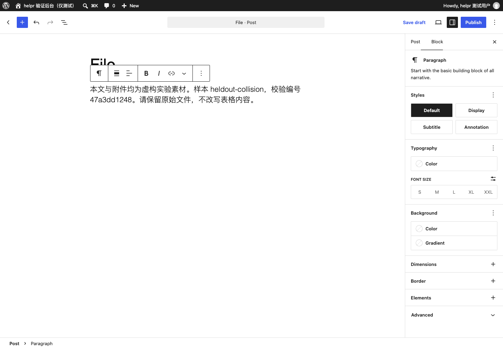

# 无需人工修订的流程归纳与条件校准：实验报告

日期：2026-10-10（America/New_York）。对应事项：[验证无需人工修订的流程归纳与条件校准](../../issues/15-autonomous-workflow-induction.md)。

**完整自动归纳没有通过。** 五轮真实探索均在上传与发布之前结束，未产生可晋升的完整流程。本轮可以排除“给模型一份 JSON 格式，再让它同时生成动作与条件即可可靠闭环”这一未经验证的假设；不能据此断言模型或自动学习普遍不可行。

取得的正面证据范围更小：自然语言要求可以绑定到带原文出处的输入；四个相近委托的目标匹配对照正确；程序固定填写内容和相等语义、模型只提议观察位置时，正文条件通过真实正反状态及另一组文字的局部复用验证。下一步应检验这种受限提议方式能否组成完整流程，见 [验证受限提议下的完整流程归纳](../../issues/16-constrained-workflow-induction.md)。

## 证据与边界

- [证据索引](artifacts/evidence-index.json)包括每轮结果、模型用量、源码摘要及辅助验证。
- [实验设计与调整记录](DESIGN.md)、[运行入口](README.md)。
- 全部网页操作发生在已有隔离 WordPress 验证后台，使用专用作者登录态和虚构素材。没有调用后台 API 或数据库代替网页操作。
- 前三轮从原始委托及当前页面开始；后两轮尝试复用本实验此前模型提出并核对过的前缀，来源保存在 `automaticPrefix`。没有给完整探索喂入旧实验的成功路径。
- 维护者调整过通用观察、失败反馈、循环控制和输出协议；这不是一个固定程序的五次重复测量。没有人工编辑候选中的网站选择器、动作绑定或成功条件。每次模型的输入、原始输出和失败都保留。
- 字段条件探针通过通用规则组合 `fill` 的相等检查：期望值直接沿用原动作的输入引用，观察位置来自模型。该组合规则是程序提供的能力，不能描述成模型独立创造了整套检查语义。
- 离线完整性回归明确借用了上一实验的辅助组装候选，只检验约束执行，不计入本轮自动学习的成果。

## 五轮探索发生了什么

| 轮次 | 模型调用 | 已返回 tokens | 结果与关键事实 |
| --- | ---: | ---: | --- |
| [首轮](artifacts/attempt-a/learn/results.json) | 16 | 164,918 | 模型把未变化的空输入标签误当成内容丢失；字段值及程序检查已正确，仍共填写标题 11 次。维护者中止重复操作，包含一次取消请求。 |
| [进度检查调整](artifacts/attempt-b/learn/results.json) | 7 | 23,045 | 重复填写消除，但动作前后的控件名称、角色及 frame 被混淆；累计五个失败后结束，正文已写入却查找旧的“空白段落”。 |
| [局部条件校准](artifacts/attempt-c/learn/results.json) | 11 | 42,411 | 导航后的条件经模型根据实际页面修正并通过；随后动作提议不是合法 JSON，探索结束。 |
| [增加一次格式修复](artifacts/attempt-d/learn/results.json) | 9 | 30,064 | 先前前缀因菜单折叠状态不同而拒绝，重新观察后通过。两次局部条件校准通过；一次语法修复仍返回同样的非法 JSON。 |
| [原生工具调用](artifacts/attempt-e/learn/results.json) | 5 | 16,154 | 四步前缀在新输入上复用通过；正文校准仍出现非法 arguments 和多包一层对象，达到两次局部校准上限后停止。 |

失败不是只有格式问题。模型在有实际字段值和成功检查证据时仍作出相反判断；又多次把动作前的定位用于动作后。使用原生工具调用改善了两次独立格式对照，但真实执行中仍出现非法参数。因此，既不能用 `json_object`，也不能用“返回了 tool call”作为参数合法、条件正确或任务已完成的证据。

自动条件修订成功过，但结果仍只证明局部步骤。任何未通过的条件、非法回复或多余包裹对象都没有被维护者手动改成候选后继续执行。失败后的诊断和截图保留；首轮关闭页面时还发生了无名称 frame 的诊断错误，后续通用观察程序已修正。

## 目标绑定和适用性

解析器从自然语言提取动态输入及连续原文引用；文件路径、名称和 SHA-256 来自本次素材。程序核对输入值确实出自原文，并固定授权与输入摘要。尚未授权的建议另存，不能自动成为内容输入。输入引用检查只证明来源和一致性，不证明模型理解没有遗漏，最终仍需独立评价。

[工具调用及适用性对照](artifacts/probes/meta.json)中，同一网站上的四种委托分别得到以下结果：

| 委托 | 期望 | 实际 |
| --- | --- | --- |
| 新建文章、公开发布原始 Excel 附件 | 可匹配 | 可匹配 |
| 只保存草稿 | 不匹配 | 不匹配 |
| 修改指定已有文章 | 不匹配 | 不匹配 |
| 读取 Excel 生成摘要、不提供原文件下载 | 不匹配 | 不匹配 |

四项在同一次工具调用中对照，没有派发浏览器动作。它们匹配的是固定目标描述，并不是一个已经学会的完整可执行流程；样本不足以估计真实误选率。负例委托没有同时要求“新建”和“修改”，也没有同时规定固定正文和生成摘要。

## 受限观察提议的真实正反证据

将正文写入条件缩小为一个观察位置提议。程序从已经绑定任务输入的 `fill` 动作继承不可变的期望值和相等语义；模型只能提出字段位置。它依据真实页面提出写入后的段落名称 `Block: Paragraph`，没有由维护者补写该定位。

[候选与组合记录](artifacts/condition-probe/candidate.json)在任何新的校准或保留集执行前保存。原动作保持不变，程序用同一个执行 Interface 执行先前四步前缀及正文填写。以下三项真实浏览器验证通过：

| 场景 | 实际证据 |
| --- | --- |
| [校准样本](artifacts/condition-probe/calibration/results.json) | 空正文时条件不通过；写入指定正文后通过；独立读取实际段落也找到完整期望正文。 |
| [未参与校准的文字](artifacts/condition-probe/heldout-collision/results.json) | 标题换成 `File`，正文换成新的文字；同一条件在填写前失败、填写后通过，无执行期模型调用或条件修订。 |
| [控件更名](artifacts/condition-probe/changed-control/results.json) | 已实际注入更名；执行在正文填写前因条件不成立停止，没有把不匹配的控件当作成功。 |

保留集在候选固定后才创建并解析。模型仍用于理解新委托；网页前缀和字段条件执行不调用模型。这符合“网页步骤复用”和“新委托理解”分别核对的要求。

这三项只验证到正文输入。虽更换了配套素材文件，文件没有上传，因此不能算换素材的完整流程复用；标题 `File` 也没有经过文件区块搜索，不能算已覆盖搜索常量碰撞。没有验证完整上传条件、发布、下载哈希、提交中断或流程修复晋升。

## 约束不能只依赖效果声明

[离线回归](artifacts/integrity-probe/results.json)先确认旧实验候选在新校验器中通过，再把其提交动作改为 `read`。与封存动作记录比较后，以 `action-or-effect-changed` 拒绝；未打开浏览器。另通过实际执行 Interface 验证，修改已授权输入后以 `task-changed` 拒绝，未派发动作。

这证明改写已有候选的效果标签不能直接绕过这里的校验。它不证明首次分类正确：本轮探索中的导航被模型标为 `read`，网站仍可能创建草稿或写入编辑偏好。未知副作用、首次提交识别和真实发布前的授权核对，仍需在完整闭环中取得证据，不能用摘要比对代替。

## 对后续设计的结论

建议继续验证有限、按阶段的小提议：目标事实和授权先固定；模型从实际观察中选择动作或观察位置；程序持有类型、执行状态、动作固有语义和不可变期望值；运行事实决定是否接受条件、保存版本或请求参与。当前证据支持测试这个方向，尚不支持将其确认为完整架构。

本轮没有进入整份流程与分段完整候选的归纳比较，也没有运行完整保留集和上传反例：所有探索都未形成完整轨迹。`compile` 与 `evaluate` 的实验入口虽已准备，代码存在不算运行证据。没有得到任何可用完整候选，也没有错误宣告完整成功；受阻后的局部字段验证不能反过来抹去前面的失败。

[后续事项](../../issues/16-constrained-workflow-induction.md)承接完整闭环的缺口。[执行组合选型](../../issues/07-browser-runtime-decision.md)及[第二后台对照](../../issues/11-second-backend-comparison.md)继续依赖该证据，不能因本项记录了结论就视为自动学习能力已成立。

## 用量与复现限制

总计 **54 次真实模型调用，已返回用量为 293,903 tokens**。其中一次取消请求没有返回 usage，其计费情况未知。前五轮探索共 48 次调用；格式及语义探针 3 次，字段条件探针 3 次。离线完整性回归不调用模型。

初始总预算为 64 次调用、220,000 tokens；首轮中止并修正驱动后，在第二轮开始前一次性调整为 64 次调用、400,000 tokens，后续各轮均扣除之前消耗，没有逐轮重置预算。局部校准最多两次，语法修复最多一次；最终因这些上限得到失败结论，未继续增加尝试。

各轮摘要及实际模型指令保存在原始记录中，当前源码另有摘要。早期驱动版本没有逐份保存为独立源文件，不能保证仅使用当前代码逐字复现早期输出。当前目录是一次性实验，不是生产实现；未针对多种模型、重复抽样或第二网站估计可靠性。
