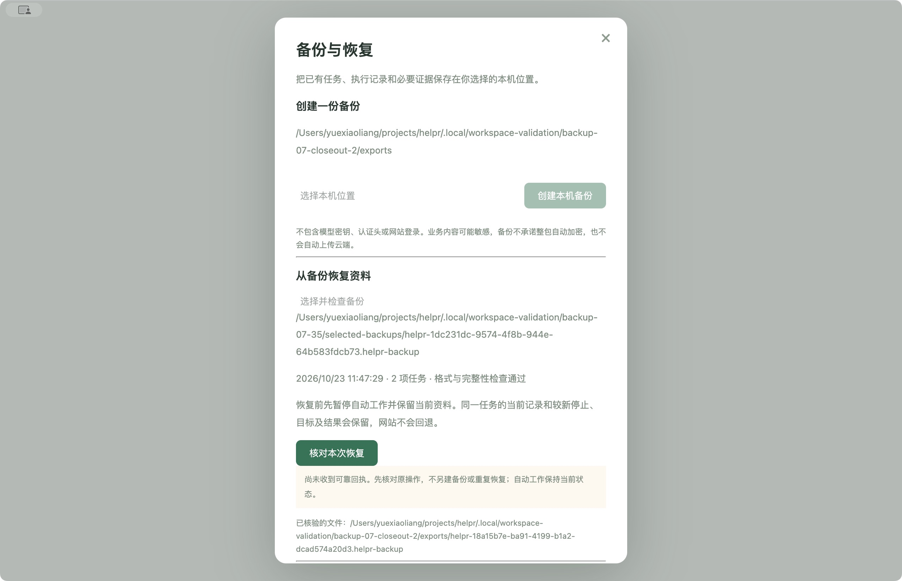
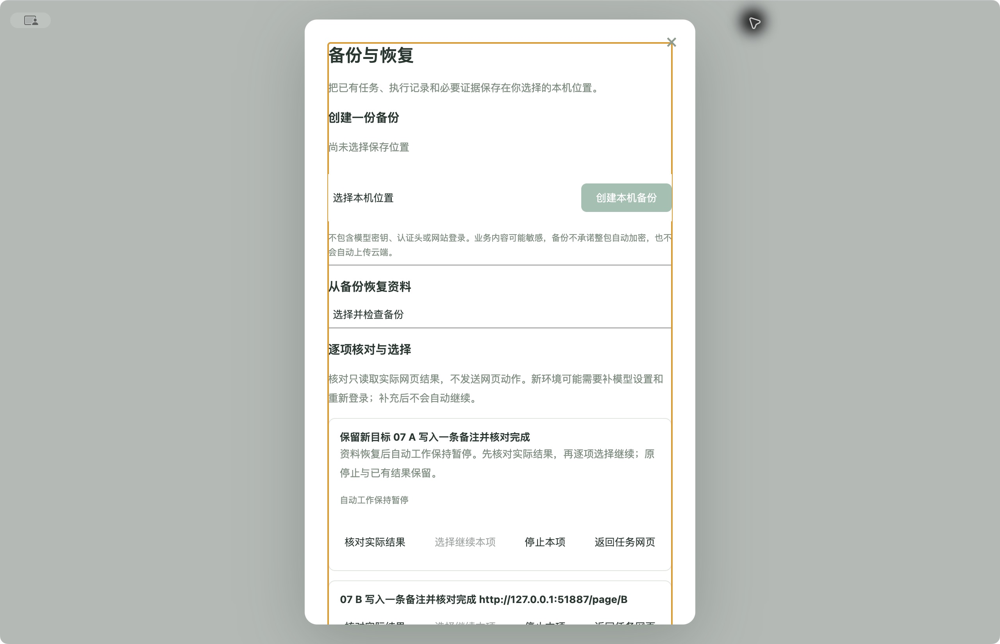

# 07 最终验收

2026-10-23，当前已有任务资料范围的 9 条验收全部完成。用户确认的原型为 `backup-v1`（`9bca802`），生产实现 `baa4858`、修正 `9435af5`，固定签名候选 35 的 app.asar 为 `4be0fc58dde4d8faaf4ef82a5425c7e31edd6c357ddbcfc5ac406f175a4ff561`。本次未替换正式安装。

[主路径及累计结果](RESULT.json)、[异常收尾记录](CLOSEOUT.json)分别保留证据来源、摘要、边界和失败。完整范围及授权见 [07 方案](../../backup-07-plan.md)。

| 验收条目 | 已核对的证据 |
| --- | --- |
| 1 一致快照与完整性 | 记录拥有者公开备份入口、真实 SQLite／文件、事务快照、格式和清单字节及 SHA-256；实包原生位置选择后生成可独立读取的归档。 |
| 2 业务资料与凭据分离 | 归档只含当前业务任务、执行、消息及必要证据；源码与实包归档排除模型密钥、认证头、设置及浏览器资料，文件保存于原生选择的本机目录。 |
| 3 失败不破坏原资料 | 损坏、缺失与不兼容输入由公开入口拒绝；实包在最多 32 MiB 的自有卷取得真实 ENOSPC，界面明确失败、无可用归档，当前记录及旧副本不变；保留副本写入失败也明确提示。 |
| 4 恢复前保留当前资料 | 旧备份先检查、再暂停并保存当前副本；独立读取确认副本含较新的目标，写入失败和切换前中断均未覆盖当前任务。 |
| 5 较新意图与网站结果 | 主轮 A 停止／修改目标后恢复早备份，B 已有网页结果不重发；异常收尾新增的 B 停止仍保留，旧归档与原副本字节保持。 |
| 6 核对与明确选择 | 新环境、历史模型用量、未知派发和迟到核对由公开入口回归；实包只读核对时 A0/B1，仅用户选择 A 后 A1/B1。未知结果不能继续；补设置或登录不自动继续。 |
| 7 说明与兼容边界 | 实际 UI 明示业务敏感内容、凭据和登录排除、版本降级区别；不兼容记录／状态模型被拒绝，原资料保留。当前上限 64 MiB，不承诺截断或整包自动加密。 |
| 8 真实效果与独立事实 | 实包主轮实际网页效果 A1/B1，独立接收端计数和归档核对；收尾原生选择、实际失败与中断界面、公开状态和独立文件互证。公共契约随后续资料类型扩展。 |
| 9 慢保存、回执与中断 | SHARED 只读夹具确认写者等待，已发布归档但回执不确定；停止尚未落盘时实际原生 gate 拒绝旧 epoch，回调计数为 0；核对沿用原归档。恢复副本 `.partial` 出现时停止并终止自有记录进程，重开版本仅增加暂停一步，证明切换尚未提交；原身份核对只生成一份对应副本，冷启动仍暂停待核对。 |

停止证据精确限定为“保存等待期间旧原生票据被拒绝”。本批无活跃 AI 竞争请求；完整竞争规则另由既有正式入口回归支持，不把该计数回调描述为新一轮完整 AI 并发验收。两项本机网页和受控模型响应只证明对应控制／备份路径，不扩展为任意网站理解、真实模型能力或升级后凭据连续性。

主轮使用启动 89／90、6 次本机受控模型和两次网页效果。异常收尾复用原两项任务及原资料，启动 91／92、5 次故障，0 新模型／网页输入收件／效果／任务，0 新构建、安装或应急清理。全部应用正常退出 `code=0`，独立 OS 检查自有 PID／进程组为空，辅助进程为空，映像已卸载且自有挂载点和文件均释放。全局累计为构建 35、安装 8、启动 92、故障 42、清理 17，未用完的预留不继续消耗。

原主轮正常退出时验证器误判 `APPLICATION_EXITING`，以及收尾准备时 `hdiutil` 空白映像参数错误的失败均保留。前者只补原时限内冷核对，后者在 0 启动／0 故障时先清理，再按本机帮助修正参数并有限重试一次；原累计预算、主动时间和失败报告没有清零或改写。

最终 `pnpm check`：13 个正式测试文件、94 项检查通过；25 项旧回归及类型、ESLint、格式、202 源码语法检查通过。两轴审阅修正了在途恢复屏障、UI 原请求身份及验证器的清理、错误归类和到期竞态；修正后的实包入口取得上述结果。

09／22 对 07 的前置交付满足。后续流程、素材及计划仍须随对应事项扩展清单、引用与恢复检查，并在 23 固定最终交付候选后复验全量资料；本报告不宣称尚不存在的数据类型已经验收。

