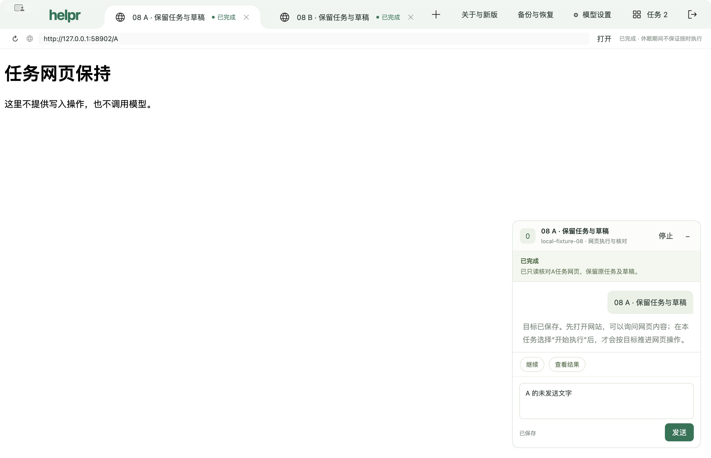

# 08 自动检查新版与可信下载提醒：最终验收

2026-10-23，08的 **7/7 条验收完成**。已确认依据为 `version-check-v1`（`23d3ecd`）及用户“可以，开始实现吧”；产品实现 `bc6607a`、`9d30fc3`，固定候选36，未替换正式安装。96沿用已审阅的验证器 `a633fa6`／`2d869a9`，用户明确批准后才追加唯一启动，锁屏等待没有消耗启动或重置批次。

本项交付只读版本检查、非抢焦点提醒、设置结果及可信手动下载入口。生产渠道当前真实版本仍为0.1.0，下载页null；没有实际0.2.0新版包。手动换装、升级准备、原密钥及有效登录延续继续由09验证。

## 条件与依据

| 08验收条件 | 结论与证据 |
| --- | --- |
| 1 可维护HTTPS来源、版本／架构与入口 | 固定公开仓库独立元数据渠道，真实HTTPS返回200／0.1.0／格式6／状态模型1／下载页null；[维护方法](../../../maintenance/version-channel.md)和[汇总](summary.json)已保存。 |
| 2 自动检查、状态与非抢焦点提醒 | 94、96启动自动检查均有实际请求；原生CUA实际核对设置、可用提醒、稍后与失败；活动任务和草稿保持。启动及24小时间隔、重复检查和历史状态的确定性检查通过。 |
| 3 隐私 | 两轮共14次实际版本请求，只有GET／Accept／Host／Connection，无业务正文、认证、Cookie或Referer；兼容比较在本机完成。受控模型的本机请求与版本服务独立记录。 |
| 4 查询没有下载安装副作用 | 只访问元数据 `/stable.json`，0包下载／安装登记／自动应用。仅94明确点击后派发一次精确关联外链，96没有外链。 |
| 5 来源、不可用、损坏、旧版和兼容限制 | 94实包10类结果通过，另有公开入口旧版、TLS、大小、内容类型、截止和取消等回归；96在两项在途执行期间再核对503及8秒版本超时。 |
| 6 可信手动下载入口 | 严格关联同仓库同版本，实际原生点击后Chrome打开精确URL，测试标签已清理。虚构0.2.0页面404只证明派发，不能充抵09的实际包取得／安装。 |
| 7 故障不破坏执行中的任务 | 独立版本服务及实际应用中的两个执行同时等待本机受控模型；新版提醒、稍后、503、超时期间，同runId、automatic意图、原草稿和活动任务保持，未阻断、取消或增加网页动作。14.595秒后释放两回应，两项均完成。见[96断言](execution-96/assertions.json)、[在途公开投影](execution-96/in-flight.json)、[完成公开投影](execution-96/complete.json)及原生界面证据。提醒投递／打开失败的独立版本公开入口检查与上述实包组合共同覆盖。 |

第7条的实包范围是**两项真实执行等待受控模型回应期间**；没有把它扩大为真实模型判断、网页写入阶段的连续执行、共享登录或23的全业务组合。这一边界不改变本项原始验收范围。

## 96实际组合

- 同候选36、94的原隔离资料／两任务／证书／网页来源；没有新任务或重新输入真实凭据。
- 自动latest之后，原生CUA实际依次检查available、点击稍后、检查503及timeout；四次在途采样均为两任务 `execution.phase=checking`、模型调用 `sending`、意图automatic，同runId，无阻断／暂停／网页动作，原生识别均true。
- 首个本机模型请求16:59:23.013，第二个晚4ms；两回应在16:59:37.608释放，重叠14.595秒，低于50秒验证上限和60秒产品截止。只读回应依据来自实际网页原句，两个执行均完成。CUA逐项核对A/B完成及两份未发送草稿，最后返回A。
- 本轮4次版本GET、2次本机受控模型、0真实模型、网页写入、包下载、安装、产品进程故障或外链。整轮16:58:00.509–17:00:18.502（Asia/Shanghai），2分17.993秒，未超过12分钟。
- 正常退出0，受管入口和独立OS复核均确认15个自有PID／3组及58902／50459夹具监听为空，见[结果](execution-96/result.json)与[OS清理](execution-96/os-cleanup.json)。没有新自有Chrome标签或应急清理。

## 工程检查与审阅

完整产品检查沿用105项正式／25项旧回归、类型／lint／格式通过，以及候选36的54个代码映像、deep／strict签名、ASAR及fuses检查。验证器修正后5个窗口准备协议案例、公开命令／回应／证据原句检查和205源码语法／25旧回归通过；没有为只改验证器重复构建产品。

### Standards

原验证器计数与根PID清理、启动RPC截止、50秒模型保留截止均经独立审阅修正。最后窗口准备修正保留15秒绝对截止和20次只读查询上限，错误逐次保留。最终证据仍须与原记录分别核对，不以一次通过清除原问题。

### Spec

原74px提醒几何修正及96在途执行组合补齐了第7条此前缺口。受控模型证据原句已与实际观察逐字核对；原型、版本服务返回与真实执行证据分别记录。原窗口准备和缩放异常继续保留，09／23在各自固定候选中复验。

## 原失败与后续边界

93隐藏启动就绪超时、94缩放准备时两条原生错误、95首条窗口查询失败完整保留在[过程报告](REPORT.md)。96首条窗口查询也返回同一通用错误，第二次在287ms后可检查隐藏窗口，随后show与宿主ready完成；这验证了有界等待修正处理该准备时序，但原95的原始TypeError没有采集，不能宣称全部启动／缩放问题已根治。96宿主日志没有新增failure事件。

本项累计1次应用构建、4次启动（93–96）、2本机模型、14版本请求、1明确外链；0安装、真实模型、网页写入、包下载、产品进程故障或应急清理。全局累计构建36/36、启动96/96、安装8/10、故障42/43、清理17/19，原计数未清零。

09对08的前置现已满足；09仍须按自身原型确认和真实两版换装要求推进，23仍须在最终完整候选复验。正式签名、公证和实际新版包未由本项提前完成。本机浏览器资料、数据库、测试CA私钥及完整运行目录留在ignore范围，只提交虚构资料的脱敏公开投影和截图。
