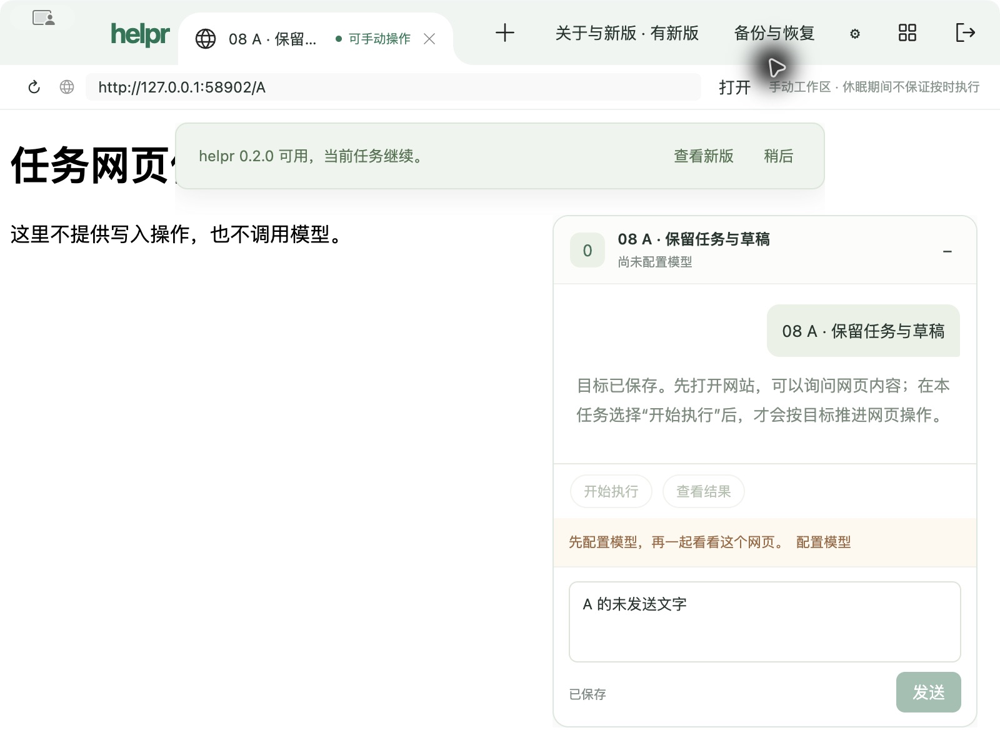

# 08 新版检查：实现与限定实包结果

2026-10-23，已按用户确认的 `version-check-v1` 实现，当前验收 **6/7 条**。第7条仍缺「执行中任务遇到检查或提醒故障」的组合证据，08尚未整体验收，09对08的前置保持。实际UI走查尽可能后台进行；用户已允许必要前台操作，没有增加真人步骤。

实现提交为 `bc6607a`、`9d30fc3`；验证入口续接和截止修正为 `38baa81`、`226b333`，审阅基点为 `3a2808d`。候选36包含最终产品代码，后两提交只改验证器，不重打包。候选未替换正式安装。

## 已实现的行为

「关于与新版」提供当前版本、来源、兼容信息、检查结果和手动重试；启动及持续运行每24小时从固定HTTPS渠道读取元数据。检查独立于业务投影和记录，失败保留历史成功但不冒充本次成功。同会话「稍后」抑制相同版本重复提醒；设置入口仍保留。只有当前成功结果中适用、精确关联的下载页可被用户明确打开，不触发退出、下载或安装。

只读渠道已建立，单独推送 `codex/updates-stable` 的元数据提交 `3d3b97a4508f206f6fd99eca32945069ec27afc1`，没有推送主分支产品代码。固定来源的独立HTTPS核对返回200／0.1.0／格式6／状态模型1／下载页null；当前确实没有新版安装包。维护方法见[版本渠道](../../../maintenance/version-channel.md)。

## 工程检查与双轴审阅

完整 `pnpm check` 通过：105项正式测试、25项旧回归、203个源码语法检查，类型、lint和格式通过。审阅修正后定向复核类型、lint及11项版本测试通过。`pnpm compile` 通过，保留Zod两条既有Rollup注释警告。候选36的54个代码映像、deep／strict签名、ASAR和fuses检查通过；签名仅用于当前Mac自用，不充抵对外Developer ID／公证。

### Standards

原审阅发现验证器可重复创建批次重置计数，以及KILL兜底遗漏根PID；已用持久化一次性身份、原现场续接守卫、自有PID与组双重清理修正。后续发现就绪阶段RPC可超出15秒原截止，已按剩余时间限定。修正后实现问题0。

### Spec

原P1为800×600下96px版本提醒遮住chat原生取样点，可能触发全局暂停；已改为74px并在实际最小窗口逐案例核对原生识别。修正后未发现新实现缺陷。验收证据仍有1项缺口：本轮两任务均未执行，不能据此关闭第7条。

Standards：实现剩余0；Spec：实现剩余0、验收证据缺口1。两轴结论分别保留。

## 实际包与独立请求

唯一受管入口为 `scripts/validate-version.mjs`；候选36、隔离资料和独立本机TLS服务固定，显式测试CA只对隔离验证客户端生效，没有关闭TLS校验或改变系统信任。产品「检查新版」「稍后」「关于与新版」「打开手动下载页」由原生CUA操作，案例返回值由独立服务生成，没有手写产品状态代替请求。

| 案例 | 独立服务返回／实际结果 |
| --- | --- |
| latest | 同版0.1.0、下载页null，显示已是最新；来自启动自动检查 |
| available | 适用的虚构0.2.0，出现非模态提醒及详情，当前任务和草稿保持 |
| offline | HTTP503，显示暂时不可用，不显示已是最新 |
| source | HTTP302，拒绝来源且不跟随重定向 |
| format | 损坏JSON，显示信息格式异常 |
| architecture | x64不适用于当前arm64，拒绝开放入口 |
| system | 最低macOS99，不适用 |
| data | 仅支持资料格式7，当前格式6不适用 |
| link | 下载页指向其它域名，拒绝开放入口 |
| timeout | 服务不结束，8秒整段截止，显示检查超时 |

共10次请求，全部为 `GET /stable.json`；完整请求头仅有Accept、Host、Connection，无任务、草稿、素材、模型、认证头、Cookie或Referer。没有包下载、安装登记或包缓存请求。公开服务测试还覆盖旧版本、TLS、响应大小、类型、链接、整段截止、请求合并、退出取消、提醒投递失败、打开失败、间隔及投影版本；这些确定性结果与实际包证据分别计。

实际点击「稍后」后从关于入口进入详情，再手动打开一次精确匹配的 `https://github.com/yuexiaoliang/helpr/releases/tag/v0.2.0`；主进程实际打开记录及Chrome标签均观察到该地址。此0.2.0为夹具虚构版本，浏览器404符合当前无真实Release的事实，只证明明确外链派发，不证明安装包可取得或换装成功。测试标签已通过Chrome原生AX关闭，用户原标签保持；扩展绑定两次30秒超时保留为工具故障，未导致再次应用启动。

## 失败、续接与清理

- 启动93在15秒宿主就绪截止失败，0请求／0任务；正常退出0，自有11个PID／3组清空。原[失败结果](result.json)未覆盖。
- 只从同一93资料、证书、候选和原20分钟绝对截止续接到94，未重置批次；先独立观察到隐藏窗口、无页面，再走公开show后就绪。此对照支持隐藏首绘制门控假设，不代表通用隐藏启动缺陷已经修复或稳定通过，见[显示前观察](pre-show.json)。
- 94准备800×600窗口时，两条 `CHROME_NATIVE_BINDING_POINT` 于08:00:47.531Z／.533Z出现，.582Z恢复；当时没有执行任务，业务基线在恢复后建立。此准备异常不是缩放稳定通过。后续所有版本案例的原生识别均为true，日志没有新增同类失败。事件见[生命周期摘要](lifecycle-events.json)。
- 原批从15:52:34至16:09:41（Asia/Shanghai），共17分7秒，未超过原20分钟截止。正常退出0，94自有15个PID／3组清空。后续独立OS核对93、94共26个PID／6组及本机夹具监听均为空，见[OS清理](os-cleanup.json)。没有应急清理、进程故障注入、模型请求、网页写入或安装。

## 验收范围与剩余

| 08条件 | 结论 | 证据 |
| --- | --- | --- |
| 1 来源、识别及入口 | 通过 | 固定渠道、真实200核对、版本与兼容比较、维护文档 |
| 2 自动检查、状态和提醒 | 通过 | 启动自动latest、实际available提醒／稍后／详情及失败界面 |
| 3 隐私 | 通过 | 10次完整实际请求，无业务或凭据；比较在本机完成 |
| 4 只读无更新副作用 | 通过 | 唯一元数据GET、0包下载／安装登记；外链仅明确点击触发 |
| 5 异常、旧版与兼容 | 通过 | 实际8类异常及公开入口旧版／TLS等回归 |
| 6 可信手动下载入口 | 通过 | 严格版本关联、实际手动外链；不冒充09真实换装 |
| 7 执行中任务隔离 | 未完成 | 所有实际capture均为manual／execution=null；只证明未执行任务、草稿和活动任务保持 |

[十案例投影和断言](captures.json)、[基线](baseline.json)、[94结果](result-94.json)与[汇总](summary.json)保存脱敏事实。原测试CA私钥、资料库和完整运行目录留在ignore范围，不作为附件。

全局累计构建36/36、启动94/94、安装8/10、故障42/43、应急清理17/19。启动已到上限，本轮不再启动应用，也不解除09依赖。隐藏首绘制和缩放准备异常作为后续09／23固定候选验证的明确限制；不能由本次版本场景通过推导其稳定性。

## 待确认的最小补验增量

只为第7条申请追加1次启动（累计上限94→95），复用候选36和原两项隔离任务，不增加构建、安装或产品进程故障。不新增任务或真实模型调用；只允许最多4次本机受控模型请求，两个请求在服务端保留，真实应用处于在途执行时通过原生CUA检查新版／503／超时及提醒／稍后，再释放回应，独立核对两任务完成、原草稿与意图、无额外网页效果。版本请求最多8次，网页写入0、包下载0、外部链接0；正常退出并独立OS清空。

单轮最多12分钟，普通命令10秒、启动15秒、版本网络8秒、正常退出20秒及OS核对8秒；0自动重试或冷重开，必要清理仅用原有额度。开始前完成入口离线检查并固定原候选哈希、资料身份及当前进程清空；若无法复用或准备失败，保留现场停止，不自动改成新资料重跑。此方案尚未执行，预算未修改。
